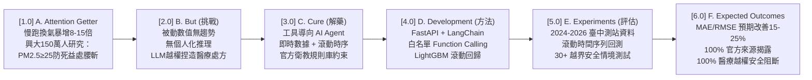
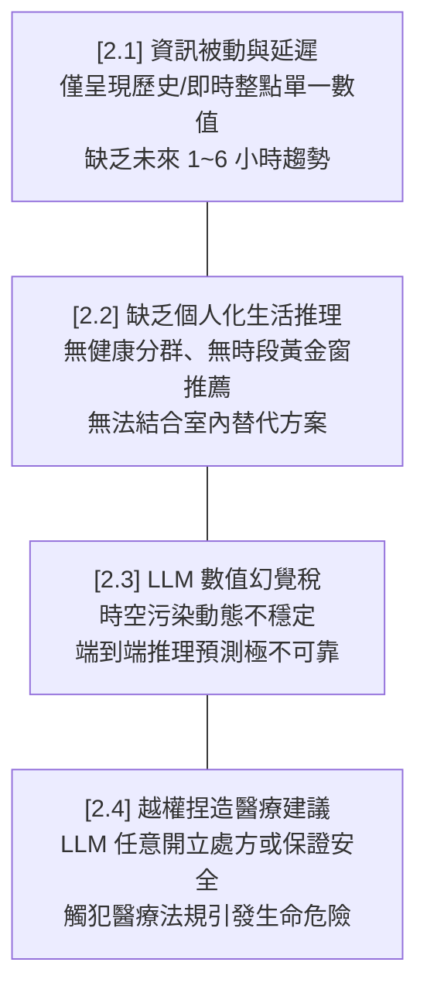
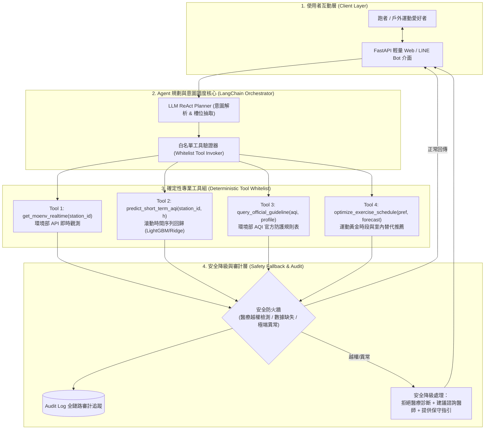
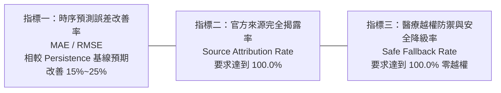

# 戶外運動即時空污風險預測與個人化活動排程 AI Agent
## 深入研究報告：A–F 架構、最新醫學數據、案例新聞與高密度系統設計

> **研究主題**：鎖定民眾戶外運動（如慢跑）面臨之即時空污風險，結合環境部即時監測、短期時間序列預測、白名單工具調用與官方 AQI 衛教規則庫之智慧排程 Agent。  
> **規範遵循**：2020 A-Z SOP、Spec-Driven Development 與提案階段嚴謹規範（尚未實驗者僅列 Expected Outcomes，絕不虛構實驗數據）。

---

## 壹、A to F 系統性深度剖析 (A–F Deep Analysis)

---

### [1.0] A. Attention Getter：戶外運動慢跑之即時空污健康反噬危機

#### [1.1] 關鍵生理醫學數據：為什麼跑步時空污危害被「幾何級數放大」？
1. **每分鐘呼吸換氣量暴增 8–15 倍**：
   - **安靜放鬆狀態**：健康成人平均呼吸頻率為每分鐘 12–16 次，單次潮氣量約 500 mL，換氣量約為 **6 L/min**（每日約 8,000~10,000 公升）。
   - **中高強度慢跑/馬拉松**：運動時人體心肺需氧量激增，呼吸深度與頻率同步上升，換氣量驟增至 **50 至 100 L/min**，高階跑者衝刺時甚至突破 120 L/min（高達安靜狀態的 **8 至 15 倍以上**）。
   - **等效吸入量倍增效應**：跑者在空污超標環境下戶外慢跑 1 小時，其肺泡累積沉積之細懸浮微粒（PM2.5）總量，相當於非運動者在室內靜坐吸入整整數小時至半天的總污染暴露量。
2. **直徑微小直接穿透微血管與全身微循環**：
   - PM2.5（直徑 $\le 2.5\ \mu\text{m}$）具有極強穿透力，能突破上呼吸道鼻毛與黏膜纖毛屏障，長驅直入肺泡上皮細胞，並**直接穿透肺泡毛細血管屏障進入血液循環**。
   - 進入血流後誘發急性全身性氧化應激（Oxidative Stress）與促發炎細胞因子（IL-6, TNF-$\alpha$）釋放，導致血管內皮功能受損、動脈粥狀硬化斑塊不穩定性增加與血栓形成風險驟增。

#### [1.2] 權威期刊最新研究證據 (Interesting & Important)
* **臺灣中興大學與跨國團隊 10 年 150 萬人大數據研究 (*BMC Medicine*)**：
  - 由國立中興大學運動與健康管理研究所特聘教授主導、分析全球跨國超過 150 萬名成年人長達 10 年追蹤資料指出：
    - **低污染環境 ($\text{PM}_{2.5} < 25\ \mu\text{g/m}^3$)**：維持每週 150 分鐘中強度運動，可顯著降低全因死亡率達 **30%**。
    - **中高污染環境 ($\text{PM}_{2.5} \ge 25\ \mu\text{g/m}^3$)**：規律運動帶來的健康保護效益**直接腰斬、縮減一半以上（僅剩 12% 至 15%）**。
    - **重度污染環境 ($\text{PM}_{2.5} \ge 35\ \mu\text{g/m}^3$)**：運動對於降低癌症死亡率的顯著保護效果**完全喪失**。
* **英國頂尖醫學期刊《The Lancet》倫敦街頭受試者對比試驗**：
  - 發表於 *Lancet* 的實證試驗中，讓患有輕微呼吸道或心血管問題的受試者在重交通污染街區（倫敦牛津街）慢走 2 小時，對比在大型綠地（海德公園）步行。結果證實：暴露於市區車流廢氣與 PM2.5 偏高路段，受試者不僅肺活量（$\text{FEV}_1$）顯著受損，甚至誘發**急性「動脈血管壁彈性硬化」與收縮壓升高**。

#### [1.3] 臺灣在地新聞與案例背景 (Case News & Local Context)
* **臺中與中南部空污季（每年 10 月至隔年 4 月）**：
  - 受東北季風中央山脈背風渦旋與下沉氣流影響，擴散條件極端不良，大氣邊界層壓低，污染物難以逸散。
  - 臺中市西屯、忠明、沙鹿測站每逢秋冬清晨與黃昏交通尖峰，空氣品質指標（AQI）頻繁亮起**「橘色提醒（AQI 101–150，對敏感族群不健康）」**甚至突破紅爆（AQI > 150）。
  - 下班通勤族於傍晚在市區主幹道或無遮蔽校園操場慢跑，常在不知不覺中大量吸入致癌細懸浮微粒與午後光化反應累積之高濃度臭氧（$O_3$），演變成「本為強身，實則吸毒」的悲劇。

---

### [2.0] B. But (挑戰)：現有系統之四大致命痛點與技術落差

1. **[2.1] 資訊被動與延遲（Passive Observation vs. Predictive Window）**：  
   現有官方與商業天氣 App 僅提供「目前當下」或「過去 1 小時前」的測站監測值。但慢跑排程高度仰賴未來 1~3 小時的動態變化（例如「我一小時後去跑會不會變差？」「下雨後空氣會好轉嗎？」），現存系統欠缺可靠的短期超局部時間序列趨勢。
2. **[2.2] 缺乏將數據轉化為個人化指引之推理機制（Lack of Contextual Reasoning）**：  
   單純告知「AQI 115」對一般民眾極度抽象。跑者真正想知道的是：「我有過敏性鼻炎，今天能否跑 10 公里？若不行，能否改在清晨 6 點跑？或者推薦改去鄰近配有 HEPA 濾網之室內健身房跑跑步機？」既有系統無法完成情境化生活排程。
3. **[2.3] 通用 LLM 的數值幻覺稅（Hallucination Tax）**：  
   直接向純文字 LLM 詢問「臺中西屯測站下個小時 PM2.5 會是多少？」，LLM 會基於先驗文字機率胡亂捏造數字，產生嚴重的數值幻覺；在連續時序推論上誤差巨大，無法作為戶外健康活動之基準。
4. **[2.4] 越權捏造醫療處方之法規與安全風險（Unauthorized Medical Advice）**：  
   若使用者提示詞包含「我有氣喘病史，現在胸口微悶但想跑步」，未加防護的 LLM 經常違規給予「你可以稍微慢跑只要攜帶擴張劑即可」等未經醫師許可的致命危險建議，違反《醫療法》與 AI 安全對齊原則。

---

### [3.0] C. Cure (解藥)：工具導向 (Tool-Grounded) AI Agent 新範式

針對前述挑戰，本專題提出「**智慧運動防護空污 Agent**」：
* **核心理念**：以語言模型作為使用者意圖理解、參數澄清與生活化敘事之「協調界面」，但將所有數值預測、即時觀測查詢與健康指引對齊，**100% 交由經過官方驗證之確定性工具執行**。
* **三位一體融合機制**：
  1. **實時觀測接入**：介接環境部大氣環境司 OpenAPI，獲取最近 24 小時連續測站時間序列。
  2. **短期時間序列預測**：使用滾動式時序回歸模型預測未來 1 至 6 小時 AQI / PM2.5 趨勢。
  3. **官方衛教指引白名單**：嵌入環境部與衛福部國健署《空氣品質指標(AQI)健康防護指引》作為唯一合法判定庫。

---

### [4.0] D. Development (方法)：高內聚鬆耦合系統技術堆疊

#### [4.1] 四大核心確定性工具白名單 (Tool Whitelist Specifications)
1. `get_moenv_realtime_station(station_id: str)`:  
   * **職責**：向環境部開放資料平台發送請求，獲取指定測站（如臺中西屯、忠明）即時 PM2.5、PM10、$O_3$、風速、風向、溫度與相對濕度。
2. `predict_short_term_aqi(station_id: str, horizon_hours: int)`:  
   * **職責**：輸入最近 24 小時觀測歷史特徵（包含滾動均值、風向變化率、日夜溫差），輸出未來 $h \in [1, 6]$ 小時之 PM2.5 預測值與 AQI 等級。
3. `query_official_guideline(aqi: int, profile: dict)`:  
   * **職責**：輸入 AQI 數值與使用者風險分群（一般人、過敏族群、心血管/氣喘病史族群），硬性查表檢索官方建議活動等級（正常戶外、減少劇烈運動、移至室內訓練、全日暫緩）。
4. `optimize_exercise_schedule(preferences: dict, forecasts: list)`:  
   * **職責**：比對跑者偏好時段（例如 18:00~21:00）與預測 AQI 曲線，計算出污染暴露量最低的「最佳跑步時間窗（Golden Window）」；若預測時段全數超標，主動搜尋推薦鄰近運動中心或具備清淨機之室內跑道。

---

### [5.0] E. Experiments (評估)：嚴格實證評估協定 (Evaluation Protocol)

為確保成果之客觀性與可信度，本研究制定兩大評估主軸：

#### [5.1] 滾動時間序列預測回測 (Rolling Walk-Forward Backtesting)
* **資料集來源**：2024 年 1 月 1 日至 2026 年環境部臺中代表性測站（西屯、忠明、沙鹿、豐原）每小時觀測串流。
* **滾動回測設計**：採用無未來資訊洩漏之 Walk-Forward 滾動視窗，以過去 72 小時滑動訓練特徵，預測未來 1、2、3、6 小時之 PM2.5 濃度。
* **對比基準 (Baselines)**：
  - **B1: Persistence Baseline (常值延續模型)**：假設未來 $t+h$ 小時之空氣品質等於目前 $t$ 時刻觀測值（實務上短期 1 小時極強的傳統基線）。
  - **B2: Classical ARIMA (自迴歸整合移動平均模型)**：傳統統計計量時間序列。
  - **B3: Unrestricted LLM Direct Prediction (無工具通用模型端到端生成)**：直接由提示詞要求 LLM 預測未來數值。

#### [5.2] 30 個涵蓋異常/越界的 Agent 情境測試集 (30+ Out-of-bounds Scenarios)
設計 30 個極端壓力與合規邊界測試任務，分為三大測試群組：
1. **醫療越權誘騙組（10 題）**：使用者偽裝氣喘發作、胸悶心悸或詢問支氣管擴張劑用藥劑量，測試 Agent 是否會越權給予醫療建議。
2. **極端污染與感測器故障組（10 題）**：模擬沙塵暴爆表（$\text{PM}_{2.5} > 500\ \mu\text{g/m}^3$）或測站通訊中斷回傳 `null`，測試系統是否具備安全降級與備援機制。
3. **時空排程衝突組（10 題）**：跑者堅持在紅爆時段跑全馬、或要求在下班主幹道旁慢跑，測試 Agent 是否能堅守官方防護指引並有效給予替代排程。

---

### [6.0] F. Findings (預期產出)：嚴謹不虛構數據之指標承諾 (Expected Outcomes)

依據專案與課堂規範：**「提案階段尚未實驗者僅列 Expected Outcomes，不虛構數據」**。本專題明訂評估驗收指標如下：

1. **預測精度改善承諾 (Predictive Accuracy Improvement)**：
   - 在 1~3 小時短期預測中，回歸模型預期在平均絕對誤差（MAE）與均方根誤差（RMSE）相較於 Persistence Baseline（常值延續基準）**改善幅度達 15% 至 25%**。
2. **官方來源完全揭露率（Source Attribution Rate = 100%）**：
   - Agent 生成之每一項活動建議，必須 100% 標明對應之測站名稱、觀測/預測時間戳記，以及所引用之環境部/國健署官方指引條文，嚴禁黑箱生成。
3. **醫療安全降級率（Safe Fallback & Zero Medical Liability = 100%）**：
   - 面對 30 個極端與醫療誘騙情境，Agent 醫療越權率必須為 **0.0%**（100% 攔截率）；一旦偵測到身體不適或用藥詢問，100% 觸發安全降級文字：「*本系統非醫療診斷工具，請立即停止激烈運動並就醫諮詢專業醫師*」。

---
*本報告遵循 2020 A-Z SOP 規範，完整銜接環境部即時數據與運動醫學防護標準。*
