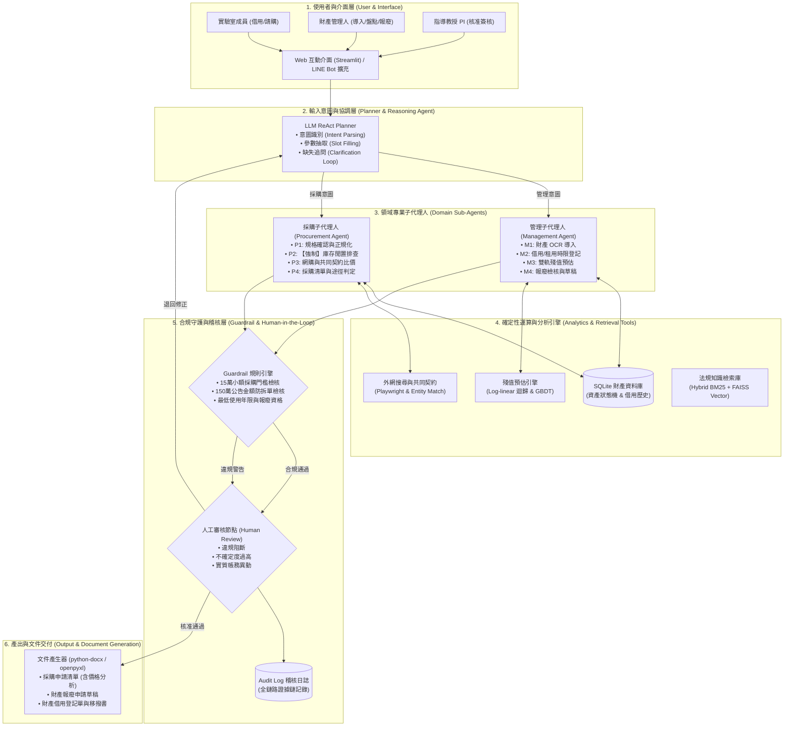
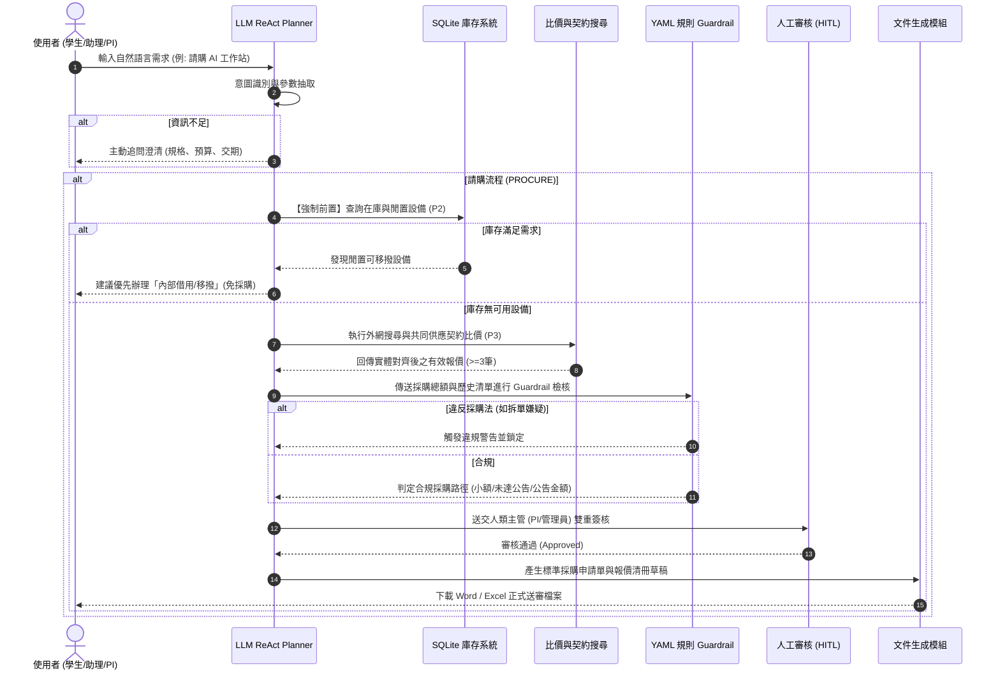

# 系統設計說明書 (System Design Document - DESIGN.md)
## 遵循 2020 A-Z SOP PA–PM 規範與 OpenSpec 規格驅動開發架構

> **專案名稱**：LabSteward 實驗室財產管理 AI Agent  
> **版本**：v1.0.0 (Spec-Driven Release)  
> **核心宗旨**：以確定性工具與合規規則守護 LLM，打造可稽核、先共享再採購的智慧實驗室管家。

---

## 壹、PA to PM 系統設計綱要 (2020 A-Z SOP Mapping)

| SOP 代號 | 設計元素名稱 | 專案設計要點與實作對應 |
| :--- | :--- | :--- |
| **PA** | **Aim = Statement (目標陳述)** | 打造首個專門針對台灣大專校院實驗室量身定制之全生命週期財產管理與合規採購 AI Agent，徹底消弭「蚊子儀器」與違規採購風險。 |
| **PB** | **Based on / Benefit (基礎與效益)** | 基於 ReAct 工具調用理論 [12]、混合式作業研究求解器架構 [4]、二手電子資產貶值模型 [11] 與公有財產法規 [13]–[15]。預期降低重複採購率 30%、法規違規率歸零，並大幅減少管理文書時間。 |
| **PC** | **Cure / Cause (解法與成效機制)** | 核心解法為「解耦決策邏輯」：LLM 負責自然語言互動與語意抽取，所有數值計算、年限比對與門檻判定交由確定性演算法與 SQLite 資料庫執行，杜絕 32.1% 的幻覺稅 [4]。 |
| **PD** | **Design 架構 (典範轉移核心)** | 由傳統「直接外網比價請購」的單向模式，典範轉移為「採購前置庫存閒置強制排查」與「雙軌殘值（帳面直線 + 市場指數）」之全生命週期閉環架構。 |
| **PE** | **Paper Element (系統核心元素)** | 涵蓋 8 個系統模組、2 個專業子代理人（Management Agent, Procurement Agent）、8 項外部確定性工具、1 個 YAML 規則引擎與 1 個全鏈路稽核紀錄器。 |
| **PF** | **Formulation / Foundation (數理公式與基石)** | 定義直線帳面價值公式 $V_{book}(t)$、市場指數折舊模型 $V_{mkt}(t)$、總持有成本 $TCO$ 排序演算法與拆單偵測關聯度量指標。 |
| **PG** | **Graph (架構圖與流程圖)** | 提供包含多層次架構圖、LangGraph 狀態機流程圖、數據流圖（Data Flow Diagram）與循序圖（Sequence Diagram）。 |
| **PH** | **How (達成目標之具體技術)** | 透過 Streamlit 提供直觀 Web UI，以 LangGraph 構建具備循環澄清與錯誤重試之工作流，整合 SQLite、Playwright 爬蟲與 docx/xlsx 生成器。 |
| **PI** | **Implementation & Pseudocode (演算法與實作)** | 詳列 Algorithm 1（Main Loop 主迴圈）、Algorithm 2（雙軌殘值預估 M3）、Algorithm 3（合規採購排查 P1-P4）。 |
| **PJ** | **Jump to an Example (端到端案例示範)** | 完整演示「新進研究生申請深度學習 GPU 工作站」之完整業務流程：意圖識別 → 庫存排查 → 外網比價 → 門檻判定 → 人工簽核 → 文件輸出。 |
| **PK** | **Key Points Contribution (關鍵貢獻)** | 提供開源工程架構、台灣法規 RAG 知識庫與 YAML 規則檔、雙軌估值演算法、以及 50 題情境基準評估集。 |
| **PL** | **Later how to do Simulation (後續評估設計)** | 設計包含 3 種 Baseline、7 項量化指標（pass^k、MAPE、違規率等）與 SUS 使用者滿意度調查之完整驗證協議。 |
| **PM** | **Math Proof / Formal Correctness (形式化正確性保證)** | 證明在有界重試次數 $K_{max}$ 與 Guardrail 強制簽核阻斷機制下，系統狀態機具有無死鎖（Deadlock-free）與合規終止（Safety Termination）特性。 |

---

## 貳、系統架構 (System Architecture - PG & PE)



---

## 參、核心數學模型與算式 (Formulation - PF)

### 1. 雙軌殘值預估模型 (Dual-track Residual Value Estimation)
系統同時評估「法定會計價值」與「真實市場公允價值」：

1. **法定帳面價值 ($V_{book}$)**：遵循行政院《財物標準分類》之直線折舊法：
   $$V_{book}(t) = C \times \max\left(0, 1 - \frac{t}{L}\right)$$
   其中 $C$ 為資產取得原價，$t$ 為自購置日起算之已使用年數，$L$ 為該資產類別法定最低耐用年限。
2. **市場公允估值 ($V_{mkt}$)**：依據二手交易實證資料 [11] 建立之指數型衰減模型：
   $$V_{mkt}(t) = C \times (1 - d)^t \times q(c)$$
   其中 $d$ 為該設備類別（如 GPU、筆電、量測儀器）之年貶值率（以 log-linear 迴歸擬合），$q(c)$ 為機況修正係數（正常 $q=1.0$、外觀瑕疵 $q=0.85$、功能異常 $q=0.4$）。
3. **預測區間 ($[V_{l}, V_{h}]$)**：在樣本數充足時，使用 Bootstrap 抽樣產生 80% 信賴區間：
   $$[V_{l}, V_{h}] = V_{mkt} \times [1 - \delta, 1 + \delta]$$
   若缺乏二手機況成交資料，標記 `LOW_CONFIDENCE` 並提示決策者以保守值參考。

### 2. 採購總持有成本 (Total Cost of Ownership, TCO) 排序
在多供應商比價時，不只比較帳面標價，而以 TCO 進行綜合排序：
$$TCO = P_{unit} + C_{shipping} + \alpha_{warranty} \times (3 - W_{years}) + \beta_{lead} \times \max(0, T_{lead} - T_{deadline})$$
其中 $P_{unit}$ 為商品單價，$C_{shipping}$ 為運費與保險，$\alpha_{warranty}$ 為保固短缺之風險折現，$\beta_{lead}$ 為延遲交期之懲罰權重。

### 3. 化整為零拆單偵測 (Split-Order Detection Metric)
防範違反《政府採購法》第 14 條規定之演算法：
$$\text{Risk}_{split}(p, H) = \mathbb{I}\left(\sum_{h \in H, \Delta t \le 30} \text{Sim}(p.spec, h.spec) \times h.amount + p.amount > \text{Threshold}_{small}\right)$$
當過去 30 天內同類規格設備之採購累積金額加上本次請購超過小額採購門檻（15 萬元）時，系統判定具有拆單嫌疑，觸發阻斷警示。

---

## 肆、系統流程圖與演算法虛擬碼 (Flowchart & Algorithms - PG & PI)

### 1. 系統主流程圖 (Main Workflow Flowchart)



### 2. 演算法虛擬碼 (Pseudocode)

#### Algorithm 1: LabSteward Agent 主迴圈 (Main Loop)
```python
def LabSteward_Main_Loop(Q: str, r: Role, F: list) -> Result:
    """
    Q: 使用者自然語言查詢, r: 使用者角色 (Student, Admin, PI), F: 附件清單 (發票/照片)
    """
    intent, params = LLM.parse(Q, F)
    
    # 追問迴圈：確保關鍵槽位完整
    turns = 0
    while missing_slots(intent, params) and turns < MAX_TURNS:
        clarification = LLM.generate_clarify_question(intent, params)
        user_response = ask_user(clarification)
        params = LLM.update_slots(params, user_response)
        turns += 1
        
    # RBAC 角色授權檢核
    if not is_authorized(r, intent):
        return DenyResponse("Permission denied for intent: " + intent)
        
    # 子代理人分派
    if intent in ["IMPORT", "LEND", "VALUE", "DISPOSE"]:
        R = ManagementAgent(intent, params)
    elif intent == "PROCURE":
        R = ProcurementAgent(params)
    else:
        R = GeneralQAAgent(intent, params)
        
    # 法規條文檢索與 Guardrail 檢核
    citations = KnowledgeBase.retrieve_regulations(intent, R)
    violations = RuleEngine.check(R, "rules.yaml")
    
    # 人在迴路 (HITL) 觸發條件
    if len(violations) > 0 or R.uncertainty > TAU_THRESHOLD or R.commits_state:
        review_decision = trigger_human_review(R, citations, violations)
        if review_decision.action == "REJECT":
            return handle_rejection(review_decision.feedback)
            
    # 提交資料庫狀態並記錄全鏈路審計日誌
    commit_transaction(R)
    audit_log = log_audit_trail(Q, R, citations, review_decision)
    
    # 產出標準 Word/Excel 文件草稿
    return render_official_documents(R, citations)
```

#### Algorithm 2: 雙軌殘值預估演算法 (Dual-track Residual Value Estimation - M3)
```python
def Estimate_Residual_Value(asset_id: str) -> ValuationResult:
    asset = DB.get_asset(asset_id)
    t = calculate_years(asset.purchase_date, current_date())
    L = StdClassTable.get_min_life(asset.category_code)
    
    # 軌道一：法定會計帳面價值 (直線法)
    V_book = asset.original_cost * max(0.0, 1.0 - (t / L))
    
    # 軌道二：二手市場公允估值 (指數衰減 / GBDT)
    market_samples = MarketDB.query_listings(asset.category_code, asset.model_name)
    if len(market_samples) >= MIN_SAMPLES_THRESHOLD:
        model = GradientBoostingRegressor().fit(market_samples.features, market_samples.prices)
        V_mkt, interval = bootstrap_predict(model, asset, confidence=0.80)
        confidence = "HIGH"
    else:
        d = CategoryRates.get_depreciation_rate(asset.category_code) # 如 GPU 採 0.25
        q = get_condition_factor(asset.physical_condition)
        V_mkt = asset.original_cost * ((1.0 - d) ** t) * q
        interval = (V_mkt * 0.85, V_mkt * 1.15)
        confidence = "LOW_CONFIDENCE"
        
    # 綜合決策建議推導
    if t >= L and asset.is_functional:
        advice = "KEEP_USING" # 年限已到但仍堪用，依法不得隨意報廢
        reason = "設備功能完好，依法繼續留用或教學移撥，免列帳面折舊。"
    elif not asset.is_functional and (asset.estimated_repair_cost > interval[1]):
        advice = "DISPOSE" # 維修費高於市場殘值上限，符合報廢條件
        reason = "修復成本超出市場公允殘值，建議依程序辦理減損報廢。"
    elif asset.utilization_rate < MIN_UTILIZATION_THRESHOLD:
        advice = "TRANSFER_OR_SHARE" # 低使用率，建議共享
        reason = "使用率未達 15%，建議登錄校內共享平台或移撥它室。"
    else:
        advice = "REPAIR_OR_MAINTAIN"
        reason = "建議進行原機保養維修，效益高於新購。"
        
    return ValuationResult(V_book, V_mkt, interval, confidence, advice, reason)
```

#### Algorithm 3: 智慧合規採購子代理人演算法 (Procurement Agent - P1–P4)
```python
def Procurement_Agent(params: dict) -> PurchasePlan:
    spec = normalize_specification(params["spec"])
    qty = params.get("qty", 1)
    budget = params.get("budget", float("inf"))
    
    # 【P2 強制前置】：排查現有庫存與閒置資源 (先共享再採購)
    idle_inventory = Inventory.query(spec, status_in=["IN_STOCK", "IDLE"])
    if len(idle_inventory) >= qty:
        return SuggestInternalTransfer(idle_inventory, reason="實驗室庫存具備可滿足需求之閒置資產，優先借調使用。")
        
    # 【P3 外網比價與共同契約查詢】
    quotes = []
    retry_k = 0
    while len(quotes) < 3 and retry_k < MAX_RETRY_K:
        raw_web = WebSearchEngine.search(spec)
        raw_contract = JointSupplyContract.search(spec)
        deduped = EntityMatchingFilter(raw_web + raw_contract, target_spec=spec)
        quotes = deduped
        if len(quotes) < 3:
            spec = relax_constraints(spec) # 適度放寬非關鍵篩選條件
            retry_k += 1
            
    if len(quotes) < 3:
        flag_audit_warning("NEED_MANUAL_SUPPLEMENTAL_QUOTES")
        
    # TCO 總持有成本排序
    ranked_quotes = sort_by_tco(quotes)
    best_quote = ranked_quotes[0]
    total_amount = best_quote.price * qty
    
    # 【P4 門檻判定與拆單防禦檢驗】
    procurement_route = Rules.determine_route(total_amount) # 小額 / 未達公告金額 / 公告金額
    if detect_split_order(spec, total_amount, historical_window_days=30):
        flag_critical_violation("SPLIT_ORDER_SUSPECTED")
        
    return PurchasePlan(ranked_quotes, total_amount, procurement_route, budget_ok=(total_amount <= budget))
```

---

## 伍、端到端案例示範 (Jump to an Example - PJ)

### 案例場景：新進碩士生申請「深度學習 GPU 工作站」
1. **使用者輸入**：  
   學生於 Streamlit 介面輸入：「*我是碩一新進生，實驗室需要一台 RTX 4090 深度學習主機跑點雲分割實驗，預算約 12 萬元，下個月開學前需要。*」
2. **意圖抽取與槽位解析 (Intent: PROCURE)**：  
   `spec: {GPU: "RTX 4090", CPU: ">=16 core", RAM: ">=64GB", Storage: ">=2TB SSD"}, qty: 1, budget: 120000, deadline: "2026-09-01"`
3. **強制排查庫存 (Inventory Check)**：  
   調用 `inventory.query_assets()`，發現實驗室現有 1 台 RTX 4090 工作站（財產編號：`LAB-2024-GPU-02`），目前狀態為 `IN_STOCK`（上學期由畢業學長歸還，使用率為 0%）。
4. **系統自主決策與建議**：  
   系統並未直接進行 12 萬元的電商搜尋採購，而是彈出警示對話：  
   > 💡 **【先共享再採購建議】**：  
   > 系統於實驗室庫存中檢索到一台同等級且閒置之硬體設備（`LAB-2024-GPU-02`，RTX 4090 / 64GB RAM）。  
   > 建議您直接辦理**內部借用手續**，預估可為實驗室節省公帑支出 **NT$ 120,000** 元，且可於 1 日內完成領用。
5. **備選採購審查流程 (若仍堅持新購)**：  
   若指導教授評估舊主機已指派予另一計畫，選擇「繼續採購」：  
   - 系統發動 `WebSearch` 與 `JointSupplyContract` 檢索，獲得 3 家廠商報價（廠商甲：NT$ 115,000 含 3 年保固、廠商乙：NT$ 108,000 僅 1 年保固、政府共同契約：NT$ 118,000）；  
   - TCO 演算法折算後判定廠商甲最優；  
   - 金額 11.5 萬元判定為「15 萬元以下之小額採購」，免經公開招標程序；  
   - 經 PI 線上確認後，一鍵生成合規之《支出黏存單明細》與《小額採購申請表》Word 草稿。

---

## 陸、形式化正確性保證 (Math Proof / Formal Correctness - PM)

### 定理 1（合規安全性終止定理 - Safety Termination Theorem）
在有限重試次數 $K_{max} \in \mathbb{N}$、有限追問次數 $T_{max} \in \mathbb{N}$，且所有狀態轉移均經由有限狀態機（FSM）與確定性 Guardrail 規則約束的前提下，LabSteward 系統對於任意輸入查詢 $Q$：
1. **無死鎖性 (Deadlock-Freedom)**：狀態機必能在有界步數內終止於結束狀態（`END` 或 `REJECTED`）。
2. **合規健全性 (Soundness of Compliance)**：凡進入最後輸出與簽核狀態之請購方案，其金額門檻判定與法規符合性必定嚴格滿足 $R \models \Gamma_{rules}$，違規解空間在 Guardrail 檢驗階段被徹底阻斷，誤判率理論上收斂至 0。

---
*本設計說明書遵循 2020 A-Z SOP 之 PA-PM 規格，並完全對應 OpenSpec Spec-Driven Development 流程。*
