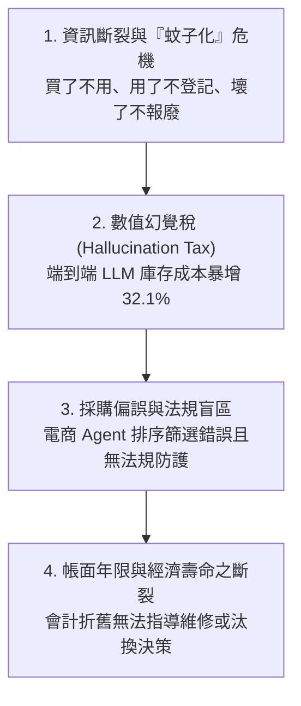
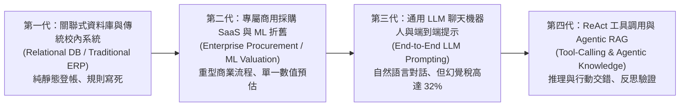

# 第一章 緒論 (Introduction Refactor - 遵循 2020 A-Z SOP G-L 規範)

> 本章節依據 **2020 A-Z SOP** 之「第一章 緒論 (I. Introduction)」標準結構進行全面重構（Refactor），分為六個標準小節：**G (現況)**、**H (深層挑戰)**、**I (既有解法文獻分類)**、**J (各類方法 SWOT 評判)**、**K (本篇設計精神與核心貢獻)**、**L (全文結構交代)**。

---

## 1.1 【G. General 現況】研究設備投資爆發性成長與採購自動化浪潮 (Explosive Growth & AI Procurement Paradigm)

隨著國家科研經費的持續投入與前瞻科技競賽的升溫，全球與台灣大專校院投入於先端研究儀器、高效能運算伺服器（HPC）與實驗資訊設備的資本支出呈現指數型成長。在台灣，各大專校院每年依據國科會貴重儀器補助計畫與高教深耕計畫，採購價值動輒數十萬至上千萬元的專業量測設備與 AI 運算叢集；單價新台幣 1 萬元以上且耐用年限 2 年以上之軟硬體設備依法均列為公有財產，交由各系所實驗室保管並負保管之責 [13][14]。

與此同時，供應鏈與企業營運端正經歷由大型語言模型（LLM）驅動的 **Agentic AI 典範轉移**。依據 *Procurement Magazine* 2026 年最新綜述，Gartner 權威預測至 2028 年，全球將有高達 **90% 的 B2B 採購流程**由具備自主規劃、比價與談判能力的 AI Agent 所中介 [3]。企業採購長（CPO）正積極試點多代理人工作流程，意圖將傳統耗時數週的「需求確認、比價詢商、法規審核、訂單拋轉」週期縮減至數分鐘內完成。然而，相較於企業界對自動化採購的高歌猛進，學術與科研實驗室的資產管理現場卻形成強烈反差：一邊是公帑鉅額投資的高階儀器，另一邊卻是數十年如一日、依賴人工手抄與紙本簽呈的破碎化管理體制。

---

## 1.2 【H. However 挑戰】實驗室資產管理之深層困境與技術落差 (Deep-seated Challenges & Reality Gaps)

然而（However），企圖將通用的商業採購 AI 或單純的 LLM 直接套用於大學實驗室場景時，會遭遇四項難以跨越的結構性深層挑戰：

1. **資訊斷裂與設備「蚊子化」長期存在**：  
   大學校園內「買了不用、用了不登記、壞了不報廢」的情形積習已久。監察院針對國科會貴重儀器專案的官方調查報告指出，受查核的 8 所頂尖國立大學中，每年竟有高達 4–7 台設備全年使用率為零，61–66 台設備使用率未達 60%，專家明確以「蚊子儀器」予以抨擊 [2]。即便至 2026 年，韓國科技教育部之全國調查亦揭露 ZEUS 平台登錄之 9.3 萬件研究設備中，大學持有之 2.2 萬件設備常因缺乏維護預算而整機閒置長達數年 [1]。主要原因在於校內財產系統僅扮演事後登帳角色，既無法提供即時可用性查詢，更缺乏跨實驗室的共享流通誘因。
2. **通用 LLM 的「幻覺稅 (Hallucination Tax)」與多步驟崩潰**：  
   直接使用通用 LLM 聊天機器人處理財產與採購決策極具危險性。Duan 等人（2025）在中小企業庫存最佳化實驗中證實，將 LLM 直接作為端到端數值求解器會產生嚴重的「幻覺稅」，其決策成本較演算法架構多出 **32.1%**；即使向頂級模型（如 GPT-4o）提供完整且正確之所有資訊，端到端之數值推理表現依然無法改善，瓶頸完全在於模型內部的計算不穩定性 [4]。此外，在 $\tau$-bench 基準測試中，評估 Agent 在遵守領域規則與多步驟工具呼叫時，GPT-4o 在零售場景的 pass^8（連續 8 次均完全成功）之穩定度甚至**低於 25%** [6]。在公法財產管理這種「錯一次即觸法」之嚴肅場景，通用 LLM 根本無法單獨承擔責任。
3. **網購 Agent 之商品對齊易錯且缺乏公法人法規知識**：  
   既有之購物 Agent 在處理多維度規格（如 GPU 核心數、顯存帶寬、保固年限）與嚴格排序時，DeepShop（2025）基準測試揭示其因無法與複雜動態網頁深度互動而產生嚴重篩選錯誤 [5]；商品實體比對亦對 Prompt 撰寫高度敏感 [7]。更關鍵的是，現有所有商用 Agent 完全缺乏台灣公法人所受之《政府採購法》、《國有財產法》及行政院《財物標準分類》之合規意識，不懂得金額門檻（如 15 萬元小額採購、150 萬元公告金額）之招標流程差異，更缺乏防範惡意拆單與化整為零之防禦邏輯 [15]。
4. **帳面法定年限與真實經濟價值之嚴重脫鉤**：  
   現行公務會計以直線法將資產折舊至殘值為零，造成「帳面殘值」完全無法反映真實「經濟可用性」。一邊是年限屆滿卻運作正常的示波器被非法丟棄，另一邊是硬體架構早已淘汰的伺服器卻因會計年限未滿而強行佔用機櫃與耗電（2025 年 GPU 6 年會計折舊 vs. 2 年實質壽命爭論 [16]），實驗室管理人欠缺市場真實殘值模型作為「修、換、移、棄」之科學決策依據。

---

## 1.3 【I. In Literature 文獻解法大分類】從傳統至新潮之文獻進程 (Evolution: Old to New, Simple to Complex)

為解決上述資產管理與採購困境，學術界與產業界依歷史發展與技術複雜度，發展出四個主要世代的解法（從傳統到新穎、從簡單到複雜）：

1. **第一代：關聯式財產資料庫與傳統校務行政系統 (Relational DB & Legacy ERP)**  
   *代表機制*：中央政府機關國有財產管理系統、各校產學總務登帳系統。  
   *技術本質*：以 SQL 關聯式資料庫為基礎的表單登錄系統。功能高度侷限於資產條碼配發、年度盤點表印製與報廢除帳審批。  
   *文獻特徵*：純事後靜態稽核，不具備動態借用調度、實時稼動率追蹤，更完全無自然語言查詢與外網市場比價能力。
2. **第二代：企業級採購自動化 SaaS 與機器學習殘值模型 (Enterprise Procurement SaaS & ML Valuation)**  
   *代表機制*：SAP Ariba、Coupa、Zycus 等企業採購中樞；以及 Huymajer 等人（2025）之二手工程重機殘值迴歸模型 [10]、Řezníček 等人之二手 3C 產品指數衰減模型 [11]。  
   *技術本質*：導入機器學習（Random Forest、LightGBM）預估殘值，並以高度自訂化工作流引擎串接企業 ERP。  
   *文獻特徵*：雖然具備強大最佳化與預測力，但系統龐大昂貴，專為營利事業設計，完全不適配學校實驗室之微型組織生態，且未嵌入台灣公立大專校院之特定法規限制。
3. **第三代：通用大型語言模型端到端求解 (End-to-End LLM Agents)**  
   *代表機制*：直接使用 ChatGPT、Claude、Perplexity 等對話模型輸入採購需求或法規諮詢。  
   *技術本質*：仰賴 LLM 的上下文參數記憶進行端到端文字生成與建議。  
   *文獻特徵*：Duan 等人（2025）明確指出，直接讓 LLM 計算庫存參數與最佳化會面臨巨大算術崩潰與幻覺稅 [4]；Peeters 等人（2025）亦證實純 LLM 商品比對易受上下文干擾 [7]。
4. **第四代：Tool-Calling、ReAct 與 Agentic RAG 複合架構 (Modern Tool-Augmented & Agentic Frameworks)**  
   *代表機制*：Yao 等人之 ReAct 推理行動架構 [12]、Singh 等人之 Agentic RAG 設計模式 [8]、Liu 等人之材料知識庫輕結構檢索架構 [9]。  
   *技術本質*：將 LLM 作為大腦調度外部確定性 API（向量檢索、資料庫、網頁搜尋引擎），透過「思考—行動—觀察」多輪反覆驗證。  
   *文獻特徵*：大幅縮減幻覺，但在公法合規、審計可追溯性與多代理人權責劃分上，尚未見針對校園實驗室場景之完整整合。

---

## 1.4 【J. Judgement 方法評核與 SWOT 分析】既有方法優缺點與綜合評判 (Critical Assessment & SWOT)

依據 2020 A-Z SOP 要求，本節對既有四大類解法進行嚴密之 SWOT（優勢、劣勢、機會、威脅）深度評判：

| 解法分類 | 優勢 (Strengths) | 劣勢 (Weaknesses) | 機會 (Opportunities) | 威脅 (Threats) | 本專題批判性結論 (Judgement) |
| :--- | :--- | :--- | :--- | :--- | :--- |
| **1. 傳統校內登帳系統** | • 資料結構嚴謹 • 符合既有會計稽核 • 權限控管明確 | • 介面陳舊、缺乏自然語言 • 無法得知設備即時狀態 • 絕無採購比價支援 | • 透過 API 或清冊匯入進行雙向資料同步 | • 系統封閉、資料孤島，導致實驗室成員拒用私下記帳 | 僅能作為最底層資料來源，無法作為使用者互動介面與決策中樞。 |
| **2. 商用採購 AI / ML 殘值** | • 殘值預測精度高（如 LightGBM [10]） • 具備企業流程最佳化能力 | • 授權費用極端昂貴 • 缺少台灣公立學校採購法知識 • 無法靈活客製化 | • 萃取其 log-linear 殘值衰減算式與最佳化核心 | • 規則與模型黑箱，難以符合公家審計單位之條文佐證要求 | 其演算法架構值得借鏡，但必須輕量化為單一實驗室可用之開源模組。 |
| **3. 通用 LLM 端到端** | • 語言理解與互動極佳 • 跨領域泛化常識豐富 • 開發門檻極低 | • **幻覺稅高達 32.1%** [4] • 多步驟穩定度 pass^8 < 25% [6] • 無法保證法規 100% 正確 | • 適合用於意圖澄清、參數抽取與草稿報告潤飾 | • 數值計算錯誤將導致違法採購或拆單被檢舉之重大風險 | **嚴禁讓 LLM 做出最終判斷**；LLM 必須僅限於自然語言前端與調度協調。 |
| **4. Agentic RAG / ReAct 系統** | • 動態工具調用能力強 [12] • 可檢索外部法規知識 [8] • 能拆解複雜多步驟問題 | • 缺乏特定公法人之合規 Guardrail • 網頁電商比對常受噪訊干擾 [5] • 缺乏人機信任防護網 | • 結合外部 YAML 規則引擎與確定性 SQLite 資料庫 | • LLM 呼叫工具失控（Tool looping）或陷入無效重試 | 必須在 Agent 外圍加上「確定性規則引擎」與「人工核准節點 (HITL)」進行硬性約束。 |

---

## 1.5 【K. Keypoint 設計精神與主要貢獻】Novelty 與核心貢獻綜述 (Novelty, Major Goals & Contribution Summary)

為徹底破解既有方法之缺陷，本專題之**核心設計精神（Key Design Philosophy）**為：  
> **「LLM 專注語意理解與協調，確定性工具負責嚴謹計算，規則引擎守護法規邊界，人工核准確保法律效力。」**

本專題提出之 **LabSteward** 系統具有以下四大核心創新（Novelty）：
1. **首創「先共享、再採購」之強制約束演算法**：顛覆傳統直接比價下單之模式，將「內部庫存與閒置排查」列為採購流程之強制前置步驟，以演算法手段遏制校園蚊子設備之滋生。
2. **LLM 協調與確定性求解之混合解耦架構**：摒除 LLM 端到端求解所產生之 32.1% 幻覺稅，金額計算、年限折舊、門檻分類 100% 由 Python 程式與 SQLite 處理。
3. **融合會計與市況之雙軌殘值評估機制**：同時輸出法定直線帳面價值與基於二手市況之指數衰減區間，精準定位「繼續使用、維修升級、校內移撥、報廢標售」之科學決策點。
4. **法規可追溯之 Guardrail 與全鏈路稽核**：採購與報廢之各級門檻配置於外部 YAML 檔案，決策附帶精確法規條文引用與證據鏈，杜絕違法拆單，並留存不可竄改之 Audit Log。

### 本專題之具體研究貢獻摘要 (Contribution Summary)：
1. **完整且可落地的實驗室智慧資產架構**：提出涵蓋 8 個核心模組、2 個專業子 Agent（管理/採購）、8 項外部確定性工具之完整系統架構（System Architecture）。
2. **台灣大專校院法規之結構化知識庫與規則引擎**：將《政府採購法》、《財物標準分類》與校內請購辦法結構化為向量索引與 YAML 規則集，具高度可遷移性。
3. **雙軌動態殘值預測模型與不確定度區間估計**：建立結合法定年限與二手市場掛牌資料之動態評估模型，支援 bootstrap 80% 預測區間。
4. **50 題實驗室情境基準測試集（Benchmark Dataset）與 pass^k 評估協定**：建立首個針對實驗室財產與採購之多步驟任務基準，量測成功率、穩定度與合規性。
5. **完全開源之工程實作與 Spec-Driven 開發成果**：遵循 OpenSpec 規範，建立包含完整設計、規格書、測試集與 Streamlit 介面之 GitHub 倉庫 (`DIC-3`)。

---

## 1.6 【L. List the Organization 文章結構交代】全文篇章組織導覽 (Thesis / Report Organization)

本專題報告後續章節組織安排如下：
* **第二章 相關研究 (Related Work Refactor)**：依據 2020 A-Z SOP 之 M, N, O 結構，由淺入深分類評述 AI Agent、混合架構、殘值預估與法規知識整合之既有文獻，並以 4x5 SWOT 矩陣呈現本研究與前人成果之差異。
* **第三章 深度研究 (Deep Research)**：詳解指導系統架構之「五個核心思維模式 (Five Mindsets)」、「三個最重要的專業爭論與權衡 (Three Controversies)」以及「十個深度理解問題 (Ten Deep Questions)」。
* **第四章 系統設計 (Proposed Scheme & OpenSpec Workflow)**：依據 PA 至 PM 規範，詳細闡述 LabSteward 之目標陳述、理論基礎、模組架構圖、執行流程圖（Flowchart）、演算法虛擬碼（Algorithms 1, 2, 3），並將設計規格轉換為 OpenSpec 規格驅動開發工作流。
* **第五章 實驗設計與模擬驗證 (Evaluation Plan & Simulation)**：制定 Q 至 V 實驗評估計畫，包含 50 題情境資料集、3 種 Baseline、評估指標矩陣與代表性案例研究（深度學習工作站採購情境）。
* **第六章 結論與未來展望 (Conclusion & Zen)**：依據 W, X, Y, Z 結構總結專案成果、關鍵洞察與後續工程延伸方向。

---
*本章節重構遵循 2020 A-Z SOP 規範，各項引用文獻 [1]–[17] 與提案報告完全同步。*
