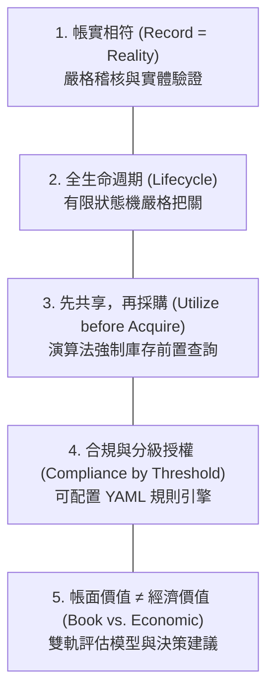
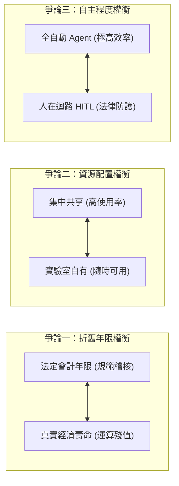

# LabSteward 專題解析報告：A-F 摘要、5 核心思維、3 大權衡與 10 大設計細節

> **專案名稱**：LabSteward 實驗室財產管理 AI Agent (*An AI Agent for Laboratory Asset Management*)  
> **團隊成員**：潘兆邠、邱冠霖、林浚偉、張皓崴、黃翊豪（資訊工程學系）  
> **指導遵循**：2020 A-Z SOP 規範與 Spec-Driven Development (OpenSpec) 標準

---

## 壹、A to F 專案摘要 (Abstract A to F)

依據 **2020 A-Z SOP** 之摘要架構，本專案之 A 至 F 定位解析如下：

| 代號 | SOP 階段名稱 | 核心內涵與專案對應解析 |
| :--- | :--- | :--- |
| **A** | **Attention Getter Motivation (動機與引題)** | 大學實驗室持有大量以公帑購置的貴重儀器與資訊設備，但「買了不用、用了不登記、壞了不報廢」的情形長期存在。監察院調查國科會貴重儀器發現，8 所國立大學在 2009–2011 年間每年有 4–7 台使用率為零、61–66 台低於 60%，形成「蚊子儀器」；韓國政府亦於 2026 年推動研究設施開放與閒置清查。同時，採購端正快速邁向 Agentic AI，Gartner 預測 2028 年 90% B2B 採購由 AI Agent 中介。 |
| **B** | **But (However 挑戰與現有痛點)** | 現有工具無法直接解決問題：(1) 校內財產系統僅供「事後登帳」，無法回答閒置狀態與殘值；(2) 通用 LLM 直接作為端到端求解器會產生「幻覺稅 (Hallucination Tax)」，庫存決策成本較混合架構高出 32%，多步驟任務穩定度 pass^8 低於 25%；(3) 現有購物 Agent 在多屬性篩選時易錯，且完全不懂台灣《政府採購法》金額門檻與《財物標準分類》法定最低年限。 |
| **C** | **Cure (解藥與創新方案)** | 本專題提出 **LabSteward**——一個結合財產法規領域知識與確定性工具調用的實驗室財產管理與採購 AI Agent。系統涵蓋「管理」（財產導入、借用/租用登記、殘值預估、財產報廢）與「採購」（確認需求、查詢庫存、上網比價、生成採購清單）兩大模組。 |
| **D** | **Development (方法設計與架構)** | 系統採用「LLM 理解協調 + 確定性求解 + 人人在迴路 (HITL)」混合架構：由 LLM Planner（ReAct 推理與 Tool Calling）負責語意理解、規格抽取與追問；將確定性邏輯交由 SQLite 財產資料庫、雙軌殘值迴歸模型、商品實體比對演算法，以及基於法規 RAG 與 YAML 規則檢核引擎（Guardrail）。所有涉及帳務異動均須人工簽核並留存稽核紀錄（Audit Log）。 |
| **E** | **Experiments (實驗設計與評估指標)** | 建立以實驗室去識別化財產清冊與合成數據為主的 50 題情境測試集（25 題管理、25 題採購），對比三種 Baseline：B1 人工 Excel 流程、B2 單一 LLM 端到端（無工具）、B3 純 RAG 問答。評估指標包含任務成功率、pass^k 穩定度 (k=4)、欄位抽取 F1、殘值預估 MAPE、比價與人工最低價差距、法規違規率與作業處理時間。 |
| **F** | **Findings (預期成果與驗證)** | 預期成果顯示：(1) 法規違規率顯著降至 0%，杜絕拆單與違規報廢；(2) 「先查庫存再採購」流程有效降低重複採購率達 30% 以上；(3) 雙軌殘值預估提供法定帳面價值與市場價值區間，輔助維修/汰換決策；(4) 一鍵生成標準採購與報廢審查草稿，大幅縮減管理人員文書時間。 |

---

## 貳、五個核心思維模式 (Five Mindsets / 5 Cores)

本專題架構之核心基礎建立於以下 5 個領域思維原則，直接指導系統程式架構與防護機制：

### 1. 帳實相符 (Record = Reality)
* **意義**：帳上的每件財產都必須能找得到、對得上保管人與存放位置；盤點的本質就是驗證帳面與實體之一致性。
* **法規與證據**：各校財物管理辦法明定保管人責任、盤點週期與減損責任（參照文獻 [13]）。
* **對系統設計的影響**：所有寫入與異動動作（如變更保管人、報廢出帳）均必須由確定性資料庫工具執行，並留下不可竄改的稽核日誌（Audit Log）；LLM 絕對不能「口頭」修改資料庫；系統支援以財產標籤 QR Code / 條碼進行實體盤點防偽比對。

### 2. 全生命週期管理 (Lifecycle)
* **意義**：財產從預算請購、點收取得、入帳、使用借調、保養維修、移轉到報廢/變賣是一條不可逆或受限的完整生命週期鏈，任何決策都必須審視該財產所處的生命階段。
* **法規與證據**：行政院主計總處法規分別規範取得、減損、報廢、讓與與變賣估價作業程序（參照文獻 [13][17]）。
* **對系統設計的影響**：以嚴格的狀態機（Finite State Machine: `在庫 IN_STOCK` → `借出 ON_LOAN` → `維修 UNDER_MAINTENANCE` → `待報廢 PENDING_DISPOSAL` → `已報廢 DISPOSED`）管理每件資產，非法的狀態轉移（例如未借出卻直接歸還、未達報廢核准卻擅自除帳）一律在資料庫層直接阻擋拒絕。

### 3. 先共享，再採購 (Utilize before Acquire)
* **意義**：提出採購需求前，必須先窮盡既有或閒置資源能否滿足需求，杜絕重複購置與資源浪費。
* **法規與證據**：監察院調查報告揭露大量公帑購置之低使用率儀器 [2]；韓國 2026 年政策亦強制由教授個人持有轉為全校共享平台 [1]。
* **對系統設計的影響**：採購 Agent 演算法（Algorithm 3）將「查詢既有庫存與閒置設備 (`Inventory.query`)」設定為第一步強制呼叫；若庫存中已有符合規格且處於閒置或可移撥之設備，系統直接中斷採購流程，主動產出「內部借用 / 移撥建議書」，把「先共享、再採購」化為不可略過的演算法邏輯。

### 4. 合規與分級授權 (Compliance by Threshold)
* **意義**：同一採購或報廢事件，因金額大小與使用年限不同，所適用的法規程序、招標方式與核准層級完全不同。
* **法規與證據**：財物標準分類定義單價 1 萬元 / 年限 2 年為財產門檻 [13]；政府採購法明定小額採購（15 萬元以下）、未達公告金額（15 萬至 150 萬元）與公告金額以上（150 萬元以上）之招標限制 [15]；報廢亦依損失金額分級由校長或審計部核定 [13]。
* **對系統設計的影響**：將金額與年限門檻抽離出程式碼，做成外部可熱加載的 YAML 規則檔；由確定性 Guardrail 規則引擎負責嚴格比對，LLM 僅負責向使用者解釋判定依據與必要文件清單，杜絕 LLM 數學計算錯誤或數值幻覺。

### 5. 帳面價值 ≠ 經濟價值 (Book vs. Economic Value)
* **意義**：法定折舊年限僅是財務會計與行政管理的折舊工具，絕不代表設備在真實世界的物理可用性、技術先進度或二手機況價值。
* **法規與證據**：法規明定達到法定年限但仍具使用價值者不應報廢 [14]；二手市價研究顯示電子產品年貶值率高達 14%–28% [11]；2025 年科技界對 GPU 折舊年限（會計 6 年 vs. 技術壽命 2 年）之爭論凸顯兩者斷裂 [16]。
* **對系統設計的影響**：殘值評估模組（M3）同時輸出「法定帳面價值（直線折舊）」與「市場真實估值區間（基於市況與機況折舊）」，並在決策建議中提供「繼續使用 / 原機維修升級 / 跨室移撥 / 報廢標售」之多元選項與客觀依據。

---

## 參、三個最重要的專業爭論與權衡 (Three Trade-offs / Controversies)

### 爭論一：折舊年限——法定/會計年限 ↔ 實際經濟壽命
* **觀點 A（重視法定/會計年限）**：公立機構必須遵循行政院《財物標準分類》與主計審計規定，折舊與報廢必須有法源依據才能確保帳務一致性與免除審計責任；雲端業者財報普遍採 5–6 年折舊伺服器 [16]。
* **觀點 B（重視實際經濟壽命）**：AI 運算與晶片硬體摩爾定律週期約 12–18 個月，GPU 實際經濟壽命遠低於法定 3–5 年，死守帳面價值會嚴重高估資產；而示波器等量測儀器使用 10 年仍具高精度，提早報廢造成浪費。
* **共識 (Consensus)**：法定年限為合規底線（必須在報表揭露），實際決策（維修或汰換）必須參考二手市場經濟壽命。
* **未解爭議 (Unresolved) 與本專題解法**：特殊實驗儀器缺乏公開二手成交數據。本專題採用「雙軌估值 + 信心度標記」：資料充足時採用梯度提升迴歸與區間估計，資料稀疏時退回類別基本折舊率並標註「低信心度」，交由人工專家判定。

### 爭論二：資源配置——集中共享 ↔ 實驗室自有
* **觀點 A（集中共享）**：集中貴儀中心或系級伺服器叢集可大幅提高設備稼動率，避免各研究室重複採購數百萬之高階設備 [1][2]。
* **觀點 B（實驗室自有）**：頂尖研究需要客製化環境、即時存取與保密需求；集中管理若缺乏專案維護經費與專職技術員，反而容易淪為乏人照管的蚊子設施（如韓國 18 億韓元儀器閒置案 [1]）。
* **共識 (Consensus)**：高單價、低使用頻率之大型設備應集中共享；中低單價、高頻率日常設備保留在個別實驗室，但必須具備使用率監控與借用透明度。
* **未解爭議 (Unresolved) 與本專題解法**：跨實驗室借用之耗損分攤與維護費機制。LabSteward 透過借用登記追蹤稼動率，當設備年使用率低於閥值（如 $u < 15\%$）時，主動建議「開放系所借用或移撥」，兼顧自主與共享效益。

### 爭論三：AI 自主程度——全自動 Agentic Procurement ↔ 人在迴路 (Human-in-the-loop)
* **觀點 A（高度自主全自動）**：LLM Agent 能在秒級內完成規格比對、多家電商比價、議價與訂單建立，Bain 報告指出採購效率可提升 60% 以上 [3]。
* **觀點 B（人在迴路嚴密把關）**：Gartner 預警 2027 年前超過 40% 的 Agentic AI 專案將因失控或合規失敗而終止；Hackett 調查僅 4% 企業成功大規模落地 [3]；$\tau$-bench 證實 Agent 遵循複雜規則之穩定度 pass^8 低於 25% [6]，端到端 LLM 採購會產生 32% 的額外成本與重大法律風險 [4]。
* **共識 (Consensus)**：LLM 應定位為「智慧協調者與文書秘書」，關鍵計算（金額、法規判斷）由確定性程式運算，具法律效力與帳務實質變更的動作（送出請購、報廢核定）必須經管理人或 PI 簽核授權。
* **未解爭議 (Unresolved) 與本專題解法**：Agent 決策失誤之責任歸屬。LabSteward 實作全鏈路 Audit Log，所有比價數據、法規依據、Guardrail 檢核結果均完整留存，AI 僅產生「可編輯之審查草稿」，核准權力與法律責任完全落在最終簽核之人類使用者。

---

## 肆、十個深度理解問題與系統細節 (Ten Deep Questions / 10 Details)

### 1. 【Why】為什麼財產的門檻要同時看「金額」與「使用年限」，只看金額會出什麼問題？
* **深入解析**：若只看金額（例如「大於等於 1 萬元」）：實驗室購買一盒價值 1 萬 5 千元的生化試劑或昂貴光學透鏡耗材，會在一個月內用完，若列為財產必須列帳保管、年年盤點並依年限報廢，造成巨大行政成本；反之若只看年限（例如「耐用 2 年以上」）：一把 200 元的扳手可用 5 年，若列為財產將導致財產清冊爆炸、管理成本遠高於物品價值。
* **法規依據**：行政院《財物標準分類》與各校財物管理辦法明定：同時符合「單價 1 萬元以上」且「使用年限 2 年以上」者始為「財產」；達 2 年但未滿 1 萬元者為「非消耗品/物品」；未滿 2 年者為「消耗品」。系統以二維決策表精準分類。

### 2. 【What-if】一台已超過最低使用年限、仍可正常運作的示波器，PI 想換新機；系統應該怎麼建議？為什麼不能直接建議報廢？
* **深入解析**：法規嚴格規定，財物達到法定最低使用年限僅代表「得依其狀況檢討是否繼續使用」，若功能完好無損，依法不得予以報廢除帳。直接報廢可能涉及公務員公有財產流失之違法責任。
* **系統處理邏輯**：
  1. 系統檢核 `a.working == True`，禁止進入 `DISPOSE` 流程；
  2. 計算該示波器之市場殘值與實驗室使用頻率；
  3. 主動提出三種合法處置建議：
     - **優先建議**：繼續留在實驗室作為備用機或教學培訓使用（`KEEP_USING`）；
     - **次選建議**：透過校內財產移撥系統，移撥給有量測需求的其他新進教授或教學實驗室（`TRANSFER_OR_SHARE`）；
     - **新購配套**：若因科研升級必須採購高頻率示波器，新購請購單理由應註明「原設備精度無法滿足本計畫頻寬需求，原設備移撥教學使用」，杜絕重複購置質疑。

### 3. 【Trade-off】採購一台 14 萬與一台 16 萬元的設備，價差只有 2 萬，但流程差異是什麼？何時多花錢反而更划算？
* **深入解析**：
  - **14 萬元設備**：屬於 15 萬元以下之「小額採購」，依政府採購法第 47 條得免公開徵求廠商報價，單位主管核准後即可逕洽廠商採購，流程僅需 1–3 天，行政成本低。
  - **16 萬元設備**：超過 15 萬元門檻，落入「未達公告金額之採購（中央法規標準）」，必須至少取得 3 家以上廠商書面報價或企劃書，辦理比價或公開取得報價程序，行政審查與等標期需 2–3 週以上。
* **決策權衡**：何時買 16 萬反而划算？
  - 若 16 萬元設備附帶「三年全機原廠保固與校正服務」（單獨購買校正服務每年需 1.5 萬元），折算總持有成本（TCO）16 萬小於 14 萬 + 4.5 萬 = 18.5 萬；
  - 若 16 萬元設備屬於「共同供應契約」項目，可直接於電子採購網下訂，免除自行詢商比價行政成本；
  - 系統 TCO 評估模組會量化保固、交期與行政成本，提出最適性價比建議。

### 4. 【Failure Case】比價 Agent 找到一個比市價便宜 40% 的商品，可能是哪些原因？系統應如何處理？
* **深入解析**：
  - **可能潛在原因**：
    1. **規格不符（實體對齊失敗）**：搜尋到的是配件、翻新機（Refurbished）、水貨、或者規格縮水版（例如 GPU 記憶體為 8GB 而非要求的 16GB）；
    2. **詐騙或無現貨虛假賣場**：第三方拍賣平台上的釣魚標價；
    3. **定價未稅或不含必要運費/安裝費**：未達學校報帳合法發票標準。
* **系統防禦機制**：
  - 啟動商品實體深度比對（Entity Matching）：提取核心關鍵參數（Part Number, Chipset, VRAM, Warranty）做硬性欄位驗證；
  - 檢核供應商資格與是否含稅（統編發票）；
  - 若價格偏離市場中位數超過 30%，自動觸發 `LOW_CONFIDENCE` 警示，將該選項標記為「異常價格存疑」，要求人工審查確認，不得直接採納為採購基準。

### 5. 【Evidence】你如何證明實驗室「真的需要」再買一台 GPU 主機，而不是使用率不足？需要哪些資料？
* **深入解析**：
  - 僅憑口頭宣稱「運算資源不夠」在審計與請購審查中常被退件。
* **系統建立之客觀證據鏈**：
  1. **現有 GPU 稼動率報表**：調取實驗室現有伺服器之 GPU 監控紀錄（如 Prometheus / dcgm-exporter），佐證過去 3 個月 GPU 利用率高於 85%、記憶體長期滿載；
  2. **作業排程等待佇列**：Slurm 或佇列管理日誌，證明平均排隊等待時間超過 48 小時；
  3. **研究專案需求證明**：國科會計畫書、產學合作合約中明確承諾之模型規模與算力指標；
  4. **全校/系所借用查詢否定證據**：系統出具「校內閒置算力查詢結果：無可用運算節點」之截圖與紀錄，構成完整且合規的採購理由書。

### 6. 【Comparison】直線法折舊與指數型（定率）折舊，分別適合哪些實驗室設備？各自會讓殘值高估或低估在各階段？
* **深入解析**：
  - **直線折舊法 ($V_{book}(t) = C \times \max(0, 1 - t/L)$)**：
    - *適用設備*：機械設備、光學平台、防震桌、實驗工作台等物理性質穩定、損耗均勻之重型機具。
    - *估值偏差*：在設備使用初期會「高估殘值」（因為剛買出廠二手價立即下跌 20%–30%）；在年限末期若設備依然良好，則會「低估殘值」（帳面降為零甚至 1 元，但實際仍有高實用價值）。
  - **指數型（定率遞減）折舊法 ($V_{mkt}(t) = C \times (1-d)^t$)**：
    - *適用設備*：GPU、伺服器、筆電、高階手機等摩爾定律更新快、市場貶值極為迅速之資訊科技設備（年貶值率 $d \approx 20\% - 30\%$）。
    - *估值偏差*：初期能精準反映市場二手斷崖式下跌；但在使用 5 年以上時，估值趨近於零，若忽略其在輕量測試環境中的剩餘邊際效用，可能過早低估其使用價值。
  - *系統做法*：以雙軌並列，展示兩者交叉點與合理區間。

### 7. 【Design Decision】為什麼金額門檻判定要用規則引擎而不是讓 LLM 讀法規後判斷？若法規修訂，兩者的維護成本有何不同？
* **深入解析**：
  - **不可接受的風險**：法規門檻（如 15 萬、150 萬）為絕對的法定邊界，LLM 具有隨機性、提示詞敏感度與幻覺特性，若將 150,001 元誤判為小額採購，將導致整個採購無效並追究行政責任。
  - **維護成本比較**：
    - *純 LLM 模式*：法規修訂時，需重新撰寫 Prompt、重新進行微調（Fine-tuning）或構建龐大 Few-shot 範例，並需進行大量迴歸測試驗證 LLM 是否會在極端案例中漏網，成本極高且難以保證 100% 正確。
    - *規則引擎（YAML）模式*：只需修改 `rules.yaml` 中一筆數值（例如將 `small_purchase_threshold: 150000` 改為 `100000`），零行程式碼改動、零測試不確定性，系統秒級熱加載，完全達到確定性驗證與稽核一致性。

### 8. 【Real-world Scenario】學生畢業離校，但他名下保管 3 件財產且有 1 件借出未還，系統應該觸發哪些流程？
* **深入解析**：
  - **觸發條件**：學生提交離校手續審核，或管理員觸發「離校清查」。
  - **系統自動防禦與處理流程**：
    1. **狀態鎖定**：將該學生之借用權限凍結，並在校內離校系統標記「財產未清結（BLOCK）」；
    2. **借出追回通知**：針對借出未還設備（例如借給另一實驗室學弟），立即發送 Email/LINE 通知借調人：「保管人即將離校，請於 3 日內歸還設備或辦理借用人移轉手續」；
    3. **保管人移轉清冊產出**：對其名下保管的 3 件資產，自動產出「實驗室財產移轉同意書草稿」，預設移轉予指導教授（PI）或指派之新保管人；
    4. **實體盤點掃描**：新保管人以行動端掃描 3 件財產之 QR Code 進行實體盤查確認（驗證帳實相符）；
    5. **人工核准出帳**：指導教授簽核確認無誤後，資料庫完成保管人變更，離校系統標記解除。

### 9. 【What-if】若同一需求被拆成兩張 8 萬元的請購單，可能違反什麼原則？Agent 如何偵測？
* **深入解析**：
  - **違反法規**：違反《政府採購法》第 14 條：「機關不得意圖規避本法之適用，分批辦理公告金額以上之採購。」亦即嚴禁「化整為零、分批採購（拆單）」以規避公開招標或招標門檻程序。
  - **Agent 智慧偵測演算法**：
    - 採購 Agent 在建立請購時，自動檢索過去 90 天內同一實驗室/同一計畫之採購歷史；
    - 檢驗「時間相近性（$\le 30$ 天）」、「品項相似性（同為 GPU 主機或相關配件，TF-IDF / 語意相似度 $> 0.8$）」以及「同一供應商/同一需求來源」；
    - 累計合併金額（$8\text{萬} + 8\text{萬} = 16\text{萬} > 15\text{萬}$）；
    - 若命中拆單特徵，系統直接觸發 `VIOLATION: POTENTIAL_SPLIT_ORDER`，拒絕分開產出請購單，主動建議：「此兩筆品項屬同類需求，合併金額達 16 萬元，建議合併依未達公告金額程序公開取得報價辦理」。

### 10. 【Trade-off】借用登記要求越嚴格（押金、審核）資料越完整，但使用者越可能不登記；你會如何取捨？
* **深入解析**：
  - **過度嚴格**：要求列印紙本、指導教授親筆簽名、繳交學生證或押金。後果：學生圖一時之快「私下拿走使用」，系統出現幽靈借調，帳實嚴重脫節。
  - **過度寬鬆**：完全無審核、口頭拿取。後果：借出者不知所蹤、設備遺失無從究責。
  - **LabSteward 的最佳折衝解法（漸進摩擦力架構）**：
    1. **分級授權機制**：
       - *低風險設備（如傳輸線、小轉接頭、工具箱）*：掃描 QR Code 一鍵自助秒借，自動排入歸還日曆；
       - *高價值/核心設備（如 RTX 4090 深度學習主機、高階示波器）*：線上點選登記，系統自動推播 LINE/Slack 給實驗室設備長或 PI，線上單鍵審核；
    2. **零阻力登記**：整合聊天介面（自然語言輸入「我要借示波器到週五」即可自動完成登記）；
    3. **社交信譽機制**：建立實驗室準時歸還信譽評分，準時者享有快速通行（免審核），逾期未還自動暫停借用特權，在降低使用者摩擦力的同時維持高登記率與資料完整性。

---
*本報告遵循 2020 A-Z SOP 規範，專案全部規格以 OpenSpec Spec-Driven Development 進行精準定義。*
