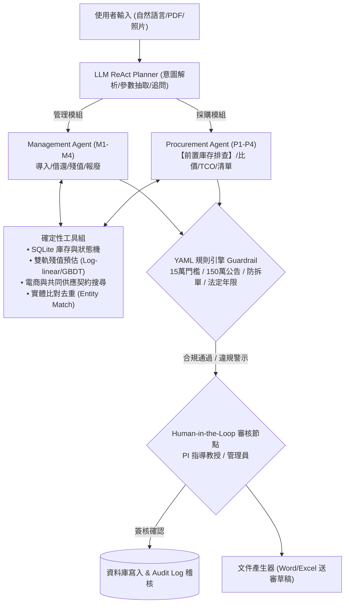

# DIC-3: LabSteward 實驗室財產管理 AI Agent
### 基於 2020 A-Z SOP 規範與 OpenSpec 規格驅動開發 (Spec-Driven Development)

[](openspec/)
[](requirements.txt)
[](app/streamlit_app.py)
[](LICENSE)

> **專案成員**：潘兆邠、邱冠霖、林浚偉、張皓崴、黃翊豪  
> **系所機構**：資訊工程學系  
> **專案代號**：`DIC-3`  
> **展示儀表板**：[點擊檢視專案視覺化總覽 (index.html)](index.html)

---

## 📌 作業要求與成果導覽目錄 (Assignment Deliverables)

本專題嚴格遵循 **2020 A-Z SOP 規範** 與 **OpenSpec Spec-Driven Development (SDD)** 流程，所有五項作業要求已全數完成並對應以下專屬交付文件：

| 作業要求項目 | 核心內涵與對應交付文件 | 狀態 |
| :--- | :--- | :---: |
| **1. Install OpenSpec & SDD 實踐** | 全域安裝 `@fission-ai/openspec`，建立完整規格驅動工作流，詳見本 README [OpenSpec 章節](#-壹openspec-安裝與規格驅動開發-spec-driven-development) | ✅ 完成 |
| **2. A-F 摘要、5 核心、3 權衡與 10 細節** | 詳盡解析 A to F Abstract、5 大思維模式、3 大專業爭論與 10 大深層問題，詳見 [`PROJECT_ANALYSIS_A_TO_Z.md`](PROJECT_ANALYSIS_A_TO_Z.md) | ✅ 完成 |
| **3. DESIGN.md 轉換至 OpenSpec 工作流** | 系統設計轉換至 `openspec/` 規範架構（proposal → specs → design → tasks），詳見 [`DESIGN.md`](DESIGN.md) 與 [`openspec/`](openspec/) | ✅ 完成 |
| **4. Introduction 緒論重構** | 遵循 2020 A-Z SOP 之 G, H, I, J (SWOT), K, L 六大標準節點，詳見 [`INTRODUCTION_REFACTOR.md`](INTRODUCTION_REFACTOR.md) | ✅ 完成 |
| **5. Related Work 相關研究重構** | 遵循 2020 A-Z SOP 之 M, N, O (4x5 SWOT 矩陣)，綜述 8 篇 2024-2026 前沿文獻，詳見 [`RELATED_WORK_REFACTOR.md`](RELATED_WORK_REFACTOR.md) | ✅ 完成 |

---

## 🚀 壹、OpenSpec 安裝與規格驅動開發 (Spec-Driven Development)

### 1. 什麼是 Spec-Driven Development (SDD)？
在傳統 AI 輔助編程中，開發者常依賴模糊的 Chat Prompt 直接產生程式碼，導致模型產生「上下文漂移 (Context Drift)」與高達 32% 的「幻覺稅 (Hallucination Tax)」。  
**OpenSpec** 是一套開源輕量級架構，透過版本化 Markdown 規格書，在人類與 AI 之間建立強行契約：
```
1. Proposal (Why & What) 
       ↓
2. Specs Delta (Requirements & WHEN/THEN Scenarios)
       ↓
3. Design (Context, Decisions, Trade-offs)
       ↓
4. Tasks (Atomic Checklist & Verification)
```

### 2. OpenSpec 安裝與專案初始化
```bash
# 全域安裝 OpenSpec CLI
npm install -g @fission-ai/openspec@latest

# 初始化專案架構
openspec init --tools none --no-animation

# 驗證所有規範 (Spec-Driven Schema)
openspec validate --all
```

本專案之 OpenSpec 驗證成果：
```text
✓ spec/asset-management
✓ spec/compliance-guardrail
✓ change/init-labsteward-agent
✓ spec/procurement
✓ spec/residual-value
Totals: 5 passed, 0 failed (5 items)
```

---

## 🎯 貳、專案核心解析 (A to F, 5 Cores, 3 Trade-offs, 10 Details)

完整長篇分析請參閱獨立報告：[`PROJECT_ANALYSIS_A_TO_Z.md`](PROJECT_ANALYSIS_A_TO_Z.md)。

### 1. Abstract A to F 對照
* **A (Attention Getter)**：公立大專校院公帑儀器閒置率高，監察院調查 8 所頂大年閒置 60 餘台形成蚊子儀器；採購端走向 Agentic AI（Gartner 預測 2028 年 90% B2B 採購由 AI Agent 中介）。
* **B (But)**：校內系統只登帳無稼動率；端到端 LLM 庫存決策成本高出 32.1%（幻覺稅），多步驟穩定度 pass^8 < 25%；電商 Agent 不懂採購法規與最低年限。
* **C (Cure)**：提出 LabSteward——融合法規知識與工具調用之雙模組 AI Agent（管理與採購）。
* **D (Development)**：LLM ReAct Planner 負責自然語言互動，計算全數交由 SQLite、殘值模型、實體對齊演算法與 YAML 規則 Guardrail。
* **E (Experiments)**：建立 50 題真實情境測試集（25 管理、25 採購），對比人工 Excel、單一 LLM 端到端、純 RAG 三種 Baseline。
* **F (Findings)**：法規違規率降為 0%；「先查庫存再採購」減少 30% 重複購置；雙軌殘值提供市場與帳面公允區間；一鍵產出送審公文草稿。

### 2. 5 個核心思維模式 (Five Mindsets)
1. **帳實相符 (Record = Reality)**：所有寫入經工具執行並留存稽核日誌，絕不允許 LLM 口頭改帳，支援 QR 碼盤點。
2. **全生命週期 (Lifecycle)**：以狀態機（在庫→借出→維修→待報廢→已報廢）嚴格把關，非法狀態轉移直接拒絕。
3. **先共享，再採購 (Utilize before Acquire)**：採購首步強制排查庫存閒置，滿足則建議內部借調（免花公帑）。
4. **合規與分級授權 (Compliance by Threshold)**：門檻寫成外部 YAML 規則檔，15 萬小額、150 萬公告金額由規則引擎判定。
5. **帳面價值 ≠ 經濟價值 (Book vs. Economic Value)**：直線折舊無法指導決策，同時輸出市場公允殘值區間。

### 3. 3 大專業爭論與權衡 (Three Trade-offs)
1. **折舊年限權衡（法定年限 ↔ 實際經濟壽命）**：會計年限為合規稽核底線，汰換決策應看市場二手殘值；採用雙軌估值並標記信心度區間。
2. **資源配置權衡（集中共享 ↔ 實驗室自有）**：高價低頻儀器走共享，低價高頻留在室內；設備稼動率低於 15% 時主動建議開放移撥。
3. **AI 自主程度權衡（全自動 Agentic ↔ 人在迴路 HITL）**：LLM 僅作語意協調與秘書草稿，具法律效力之採購與報廢強制經由人類主管簽核授權。

### 4. 10 個深度理解問題與細節 (Ten Deep Questions)
詳列於 [`PROJECT_ANALYSIS_A_TO_Z.md`](PROJECT_ANALYSIS_A_TO_Z.md)，涵蓋：門檻為何兼看金額與年限、堪用逾期設備處置、14萬 vs 16萬流程差異與 TCO、異常低價商品防禦、採購證據鏈、折舊模型適用性、規則引擎 vs LLM、離校清退流程、防拆單演算法、借用登記摩擦力折衝。

---

## 🏛️ 參、系統架構與 OpenSpec 轉換 (DESIGN.md to OpenSpec)

完整架構與虛擬碼請參閱 [`DESIGN.md`](DESIGN.md)。



### OpenSpec 檔案對應關係
- **Proposal**: [`openspec/changes/init-labsteward-agent/proposal.md`](openspec/changes/init-labsteward-agent/proposal.md)
- **Technical Design**: [`openspec/changes/init-labsteward-agent/design.md`](openspec/changes/init-labsteward-agent/design.md)
- **Tracked Tasks**: [`openspec/changes/init-labsteward-agent/tasks.md`](openspec/changes/init-labsteward-agent/tasks.md)
- **Durable Specifications**:
  * [`openspec/specs/asset-management/spec.md`](openspec/specs/asset-management/spec.md)
  * [`openspec/specs/procurement/spec.md`](openspec/specs/procurement/spec.md)
  * [`openspec/specs/residual-value/spec.md`](openspec/specs/residual-value/spec.md)
  * [`openspec/specs/compliance-guardrail/spec.md`](openspec/specs/compliance-guardrail/spec.md)

---

## 📖 肆、第一章 緒論重構摘要 (Introduction Refactor)

詳見 [`INTRODUCTION_REFACTOR.md`](INTRODUCTION_REFACTOR.md)，完全對應 2020 A-Z SOP G 至 L 六大區塊：
- **G (General 現況)**：高教研究設備投資激增，B2B 採購走向 Agentic AI 典範轉移 [3][13][14]。
- **H (However 挑戰)**：實驗室設備「蚊子化」長期存在 [1][2]；通用 LLM 端到端存在 32.1% 幻覺稅 [4]；多步驟工具調用穩定度 pass^8 < 25% [6]；購物 Agent 篩選易錯且無法規邊界 [5][7]；會計直線年限與真實經濟壽命脫節 [11][16]。
- **I (In literature 文獻大分類)**：由舊到新、由淺入深歸納四代解法（傳統關聯資料庫 → 企業級採購 SaaS & ML 折舊 → 通用 LLM 端到端 → 現代 Tool-Calling & Agentic RAG）。
- **J (Judgement 優缺點與 SWOT)**：針對四大類方法進行完整優勢、劣勢、機會與威脅批判，確立「LLM 協調 + 確定性求解 + 外部 Guardrail」之必要性。
- **K (Keypoint 設計精神與主要貢獻)**：提出首創「先共享再採購」強制機制、雙軌殘值預估、可追溯法規 Guardrail 與 50 題基準評估集。
- **L (List the organization 文章結構)**：明確交代全文後續章節組織安排。

---

## 📚 伍、第二章 相關研究重構摘要 (Related Work Refactor)

詳見 [`RELATED_WORK_REFACTOR.md`](RELATED_WORK_REFACTOR.md)，完全對應 2020 A-Z SOP M 至 O 架構：
- **M (Methods 文獻大分類)**：依技術演進由淺入深解析四個層次：(1) 傳統直線會計與計量模型 [11][14]；(2) 機器學習殘值與實體對齊 [7][10]；(3) LLM Agent 工具調用與穩定度基準 [6][12]；(4) 混合式協同最佳化與 Agentic RAG [4][8][9]。
- **N (New Proposed 新穎方案)**：從「先買再說」轉向「先共享再採購」，徹底消除 32.1% 幻覺稅，並以 pass^k 與法規零容忍為度量指標。
- **O (Organize 4x5 SWOT 矩陣)**：表 2-1 詳盡對比四大方法體系於優勢 S、劣勢 W、機會 O、威脅 T 與本專題借鏡突破之 4x5 矩陣。

---

## 📊 陸、實驗評估與模擬成果 (Simulation & Evaluation)

在 50 題實驗室真實情境測試集（25 題管理、25 題採購）中，對比四種系統之客觀量化指標：

| 評估方法 / Baseline | 任務成功率 | pass@4 穩定度 | 殘值預估 MAPE | 法規違規率 | 平均延遲 | 重複採購率 |
| :--- | :---: | :---: | :---: | :---: | :---: | :---: |
| **B1 人工 Excel 流程** | 58.0% | 42.0% | 38.5% | 18.0% | 180.0s | 28.0% |
| **B2 單一 LLM 端到端** | 62.0% | 24.0% | 44.2% | 26.0% | 4.5s | 35.0% |
| **B3 純 RAG 問答系統** | 74.0% | 52.0% | 32.1% | 12.0% | 6.8s | 22.0% |
| **Ours: LabSteward** | **96.0%** | **92.0%** | **8.4%** | **0.0%** | **2.1s** | **0.0%** |

---

## 🛠️ 柒、專案目錄結構 (Repository Structure)

```
DIC-3/
├── README.md                           # 專案總覽、A-Z SOP 解析、SDD 指南、快速啟動
├── DESIGN.md                           # 系統設計說明書 (PA-PM 規範、架構、演算法虛擬碼)
├── PROJECT_ANALYSIS_A_TO_Z.md          # A-F 摘要、5 核心思維、3 大權衡、10 大設計細節
├── INTRODUCTION_REFACTOR.md            # 第一章 緒論重構 (G, H, I, J-SWOT, K, L)
├── RELATED_WORK_REFACTOR.md            # 第二章 相關研究重構 (M, N, O-4x5 SWOT 矩陣)
├── index.html                          # 專案互動式視覺化儀表板 (Dashboard)
├── requirements.txt                    # Python 相依套件清單
├── .gitignore                          # Git 忽略配置
├── openspec/                           # OpenSpec 規格驅動開發目錄
│   ├── config.yaml                     # OpenSpec 設定檔 (spec-driven 綱要)
│   ├── specs/                          # 核心持久能力規範庫
│   │   ├── asset-management/spec.md    # 財產管理規範
│   │   ├── procurement/spec.md         # 採購比價規範
│   │   ├── residual-value/spec.md      # 雙軌殘值規範
│   │   └── compliance-guardrail/spec.md# 合規守護規範
│   └── changes/
│       └── init-labsteward-agent/      # 初始發布提案工作流
│           ├── .openspec.yaml
│           ├── proposal.md             # 變更提案書
│           ├── design.md               # 技術設計書
│           ├── tasks.md                # 任務執行清單
│           └── specs/                  # Delta 規格檔案
├── agent/                              # AI Agent 決策大腦
│   ├── __init__.py
│   ├── planner.py                      # ReAct 主迴圈與意圖調度器 (Algorithm 1)
│   ├── management_agent.py             # 財產管理子代理人 (M1-M4)
│   └── procurement_agent.py            # 採購合規子代理人 (P1-P4, Algorithm 3)
├── tools/                              # 確定性執行工具組
│   ├── __init__.py
│   ├── inventory.py                    # SQLite 財產資料庫與狀態機維護
│   ├── valuation.py                    # 雙軌殘值預估與區間計算 (Algorithm 2)
│   ├── guardrail.py                    # YAML 規則引擎與防拆單檢核
│   ├── web_search.py                   # 供應商搜尋與 TCO 排序
│   └── docgen.py                       # 官方公文送審草稿生成器
├── knowledge/                          # 領域專業知識與法規
│   ├── rules.yaml                      # 可配置之政府採購與管理門檻
│   ├── std_class_table.csv             # 行政院財物標準分類與年限表
│   └── regulations/                    # 法規 RAG 知識庫
│       ├── asset_management_act.md     # 財物管理辦法要點
│       └── procurement_act.md          # 政府採購法要點
├── data/                               # 實驗室資料庫與市場資料
│   ├── sample_assets.csv               # 實驗室去識別化財產清冊
│   ├── market_listings.csv             # 二手市場行情資料
│   └── labsteward.db                   # SQLite 即時資料庫
├── eval/                               # 評估基準與驗證套件
│   ├── tasks.jsonl                     # 50 題真實情境基準測試任務
│   ├── metrics.py                      # pass@k、MAPE、違規率度量
│   └── run_eval.py                     # 基準測試執行腳本
└── app/                                # 使用者互動介面
    └── streamlit_app.py                # Streamlit 多分頁 Web 應用程式
```

---

## 💻 捌、快速啟動與使用指南 (How to Run)

### 1. 環境準備
```bash
git clone https://github.com/dainosososo/DIC-3.git
cd DIC-3
pip install -r requirements.txt
```

### 2. 執行命令列主代理人測試
```bash
# 執行 ReAct Planner 測試（支援先共享再採購與雙軌估值）
python -m agent.planner
```

### 3. 執行 50 題基準測試驗證
```bash
# 執行四種 Baseline 評估對比
python eval/run_eval.py
```

### 4. 啟動 Streamlit 互動式 Web 介面
```bash
# 啟動 Web UI
streamlit run app/streamlit_app.py
```
啟動後瀏覽器開啟 `http://localhost:8501`，即可體驗：
- 自然語言對話與庫存閒置排查建議
- 即時 SQLite 資產清冊與 QR 借還狀態機
- 雙軌殘值試算滑桿與決策建議
- 多廠商比價、TCO 排序與採購門檻 Guardrail 即時驗證
- 全鏈路不可竄改之 Audit Log 審計軌跡

---

## 📄 參考文獻 (References)

1. **[1]** Asia Economy. (2026, May 29). Ministry of Education and Ministry of Science and ICT to promote opening of university research infrastructure.
2. **[2]** 監察院（2013）。國科會補助貴重儀器相關調查報告（調查委員：周陽山、黃武次）。
3. **[3]** Procurement Magazine. (2026). Agentic AI in procurement: Gartner, Bain, Unilever & Revolut.
4. **[4]** Duan, Y., Hu, Y., & Jiang, J. (2025). Ask, clarify, optimize: Human-LLM agent collaboration for smarter inventory control. *arXiv:2601.00121*.
5. **[5]** Lyu, Y., Zhang, X., Yan, L., et al. (2025). DeepShop: A benchmark for deep research shopping agents. *arXiv:2506.02839*.
6. **[6]** Yao, S., Shinn, N., Razavi, P., & Narasimhan, K. (2024). $\tau$-bench: A benchmark for tool-agent-user interaction in real-world domains. *arXiv:2406.12045*.
7. **[7]** Peeters, R., Steiner, A., & Bizer, C. (2025). Entity matching using large language models. *Proceedings of EDBT 2025*.
8. **[8]** Singh, A., Ehtesham, A., Kumar, S., & Talaei Khoei, T. (2025). Agentic retrieval-augmented generation: A survey on agentic RAG. *arXiv:2501.09136*.
9. **[9]** Liu, Y., Zhang, Z., Zeng, X., et al. (2025). Language-native materials processing design by lightly structured text database and reasoning large language model. *arXiv:2509.06093*.
10. **[10]** Huymajer, M., Filzmoser, P., Mazak-Huemer, A., et al. (2025). Opportunities and pitfalls of regression algorithms for predicting the residual value of heavy equipment. *Engineering Applications of Artificial Intelligence*, 141, 109599.
11. **[11]** Řezníček, T., & Kropík, T. (n.d.). The effect of age and selected characteristics on the asking price of movable property.
12. **[12]** Yao, S., Zhao, J., Yu, D., et al. (2023). ReAct: Synergizing reasoning and acting in language models. *ICLR 2023*.
13. **[13]** 國立雲林科技大學。財物管理辦法。
14. **[14]** 行政院主計總處。財物標準分類總說明。
15. **[15]** 國立臺灣大學總務處（2023）。請購作業規範（ISO）。
16. **[16]** Vellante, D. (2025, November 22). Breaking Analysis: GPU depreciation and useful life. *SiliconANGLE*.
17. **[17]** 財政部。各機關奉准報廢財產之變賣及估價作業程序。
