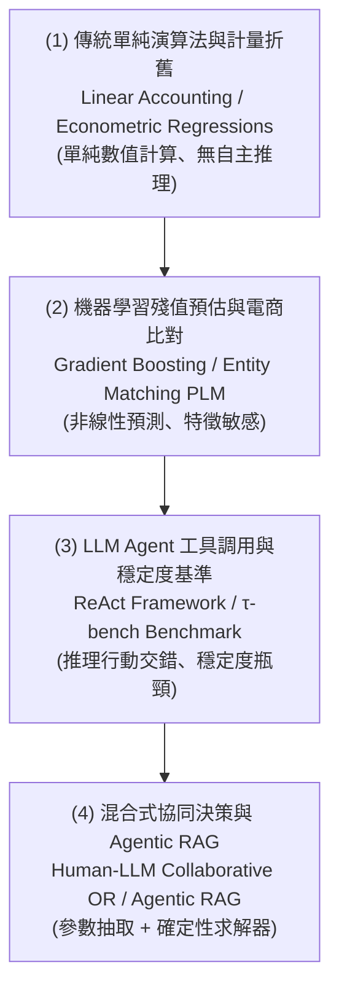
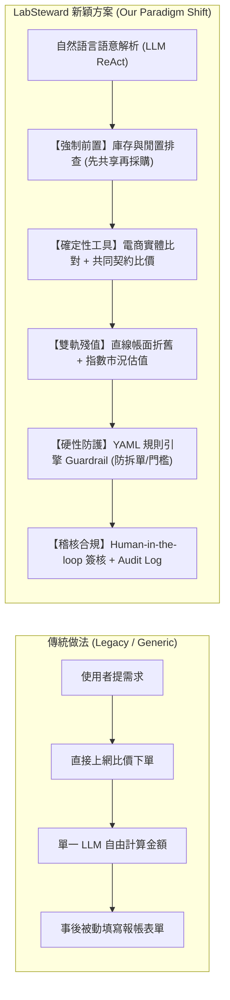
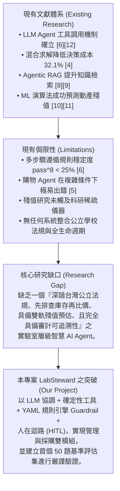

# 第二章 相關研究 (Related Work Refactor - 遵循 2020 A-Z SOP M-O 規範)

> 本章節依據 **2020 A-Z SOP** 之「第二章 相關研究 (II. Related Work)」標準結構進行全面重構（Refactor），分為三個標準小節：**M (方法文獻由舊到新、由淺入深大分類)**、**N (最新趨勢與本篇新穎方案 New Proposed)**、**O (基於 Judgement 之 4x5 SWOT 矩陣歸納 Organize)**。

---

## 2.1 【M. Methods 文獻解法演進與分類】由舊到新、由淺入深之技術體系 (From Old to New, Simple to Complex)

本研究回顧資產管理、智慧採購、殘值預估與法規遵循四大領域之代表性文獻，將現有方法依技術演進歷程與架構複雜度歸納為四個主要層次：

### (1) 第一層次：傳統會計直線折舊與計量經濟模型 (Classical Accounting & Econometric Baselines)
公立大專校院與政府行政機關長期仰賴行政院主計總處《財物標準分類》[14] 所規定之「直線折舊法」（Straight-Line Depreciation Method）。其核心公式為：
$$V_{book}(t) = C \times \max\left(0, 1 - \frac{t}{L}\right)$$
其中 $C$ 為初始取得成本，$t$ 為已使用年數，$L$ 為法定最低耐用年限。此類方法的本質是為了會計帳務一致性與審計防弊，假設資產價值在生命週期內等速減損至殘值為零。然而在現實世界中，Řezníček 與 Kropík [11] 以二手平台 2,100 筆真實掛牌交易資料進行實證研究，證明筆記型電腦（年貶值約 14.4%）與智慧型手機（年貶值約 28.2%）等電子科技產品呈現顯著的**指數型衰減（Log-linear 曲線）**，直線折舊法在設備使用前中期會大幅高估資產價值，在後期則將仍堪用之資產低估為殘值一元，完全無法作為實驗室設備是否應該維修或汰換之決策參考。

### (2) 第二層次：機器學習殘值預測與商品實體對齊 (ML Residual Valuation & Entity Matching)
為克服傳統折舊模型的剛性限制，學者開始導入機器學習演算法：
- **機具殘值預測**：Huymajer 等人（2025, *Engineering Applications of Artificial Intelligence*）[10] 針對重型工程機具之真實拍賣交易資料庫，評估了線性迴歸、Random Forest、XGBoost 與 LightGBM 等多種機器學習演算法。研究發現非線性梯度提升樹模型在殘值預估準確度上顯著超越傳統計量經濟學模型，但模型的預測性能極度依賴高品質特徵工程（如品牌、規格參數、機況與歷史保養）[10]。然而該研究聚焦於高流動性之重型工程車輛，尚未能推廣至交易資料極度稀疏、規格異質性極高之科研量測儀器。
- **商品實體對齊 (Entity Matching)**：在採購比價端，Peeters 等人（EDBT 2025）[7] 評估了預訓練語言模型（PLM）與大型語言模型在 WDC Products 等電商資料庫之跨平台商品比對表現。研究顯示頂級 LLM 即使在零樣本（Zero-shot）條件下亦能在半數資料集上擊敗經過微調的專屬小模型，但 LLM 對提示詞（Prompt）之句式結構與規格排列順序具有極高的敏感性，經常因網頁廣告冗餘字串或贈品描述而產生誤配 [7]。

### (3) 第三層次：LLM Agent 工具調用機制與穩定度瓶頸 (Tool-Calling Agents & $\tau$-bench)
大型語言模型由單純文本生成邁向具備自主行動能力的 Agent：
- **ReAct 框架**：Yao 等人（ICLR 2023）[12] 提出 ReAct 架構，使語言模型能夠在「思考 (Thought)」、「行動 (Action)」與「觀察 (Observation)」三者之間交錯循環，奠定了當代 Tool Calling Agent 之理論基石。
- **多步驟環境下的脆弱性**：然而，Yao 等人（2024）進一步在 $\tau$-bench 基準測試中，評估 Tool-Calling Agent 在面對使用者動態干預與嚴格領域業務規則下的真實表現 [6]。實驗揭露驚人事實：即使是頂級商業模型 GPT-4o，在零售場景（$\tau$-retail）的單次任務成功率僅約 61%，而在要求連續 8 次嘗試均完全無誤的嚴格指標 **$pass^8$ 更是暴跌至 25% 以下** [6]。這項研究給予實驗室資產管理重大警示：在受《政府採購法》與審計法規嚴格規範的場景中，單純依賴 LLM 的自主多步驟決策具有極高之違規風險。

### (4) 第四層次：混合式協同架構與 Agentic RAG (Hybrid Solvers & Agentic RAG)
針對 LLM 純文字推理能力與精準數值計算之落差，最新研究開創了混合式架構：
- **Human-LLM Agent 協同最佳化**：Duan 等人（2025, arXiv:2601.00121）[4] 在中小企業隨機需求庫存管理中，對比了「LLM 端到端求解」與「LLM 負責語意參數擷取 + 外部作業研究 (OR) 演算法求解」兩種架構。實證結果顯示，混合式架構使整體營運成本大幅降低 **32.1%**；更關鍵的發現是：即便向 LLM 餵入 100% 完美準確之庫存與需求資訊，端到端 LLM 的決策績效依然毫無改善，證明數值決策的瓶頸根源於神經網路之計算推理本質而非外部資訊之多寡 [4]。
- **Agentic RAG 與結構化文字資料庫**：Singh 等人（2025）[8] 綜述了由 Agent 自主決定檢索策略、多步查證的反思型 RAG 範式；Liu 等人（2025）[9] 則利用 3,500 篇材料專業論文建立輕結構文字資料庫，結合稠密向量檢索、BM25 關鍵字與數值硬性過濾，將檢索首筆命中率由 33.3% 大幅提升至 56.4%，並成功引導實驗室合成實驗 [9]。

---

## 2.2 【N. New Proposed 新趨勢與新穎方案】LabSteward 系統創新 (New Trends & Novel Scheme)

綜合上述技術演進脈絡，目前的學術界與產業界存在一條鮮明的**研究斷層（Research Gap）**：  
> **既有研究要麼將焦點置於泛用電商之消費性購物 Agent，要麼孤立探討重型機具之折舊預估，從未有任何研究將「公立學校財產全生命週期管理」、「政府採購法規嚴格防禦」、「庫存前置排查」與「雙軌殘值決策」整合於單一輕量化 Agent 系統之中。**

為填補此研究斷層，本專題提出 **LabSteward**，其核心創新點與技術典範轉移如下：

1. **典範轉移一：從「先買再說」轉向「先共享、再採購」之演算法強制機制**  
   傳統採購 Agent 均以最大化採購效率為目標，助長了重複購買與蚊子設備；LabSteward 於演算法層級（Algorithm 3）將查詢自有 SQLite 資料庫之 `IN_STOCK` 與 `IDLE` 設備設為第一優先門檻，若既有資源足以滿足需求，立即中斷採購並生成內部借調草稿。
2. **典範轉移二：從「LLM 端到端求解」轉向「LLM 協調 + 確定性求解 + 外部 Guardrail」**  
   借鏡 Duan 等人 [4] 之洞見，徹底摒除 LLM 於數值計算與法規門檻上之自由裁量權。金額門檻、折舊計算與拆單防禦全數由外部 Python 模組與 YAML 規則檔案負責，LLM 僅專注於前端意圖澄清、非結構化規格解析與人機介面解釋，完全消除 32.1% 的幻覺稅。
3. **典範轉移三：從「單純會計折舊」轉向「會計規範與二手市況雙軌模型」**  
   結合理論直線法與實證指數衰減模型，提供決策者完整的價值光譜與 80% bootstrap 預測區間，給出包含「繼續使用、原機維修、跨室移撥、報廢標售」之科學行動建議。
4. **典範轉移四：以 pass^k 與法規零容忍為核心之評估基準**  
   導入 Yao 等人 [6] 之嚴格評估標準，捨棄易被虛假繁榮掩蓋之平均成功率，以連續多次無差錯之 $pass^k$ 穩定度與法規違規率作為核心評估度量。

---

## 2.3 【O. Organize 評判矩陣與 4x5 SWOT 歸納】全面歸納與綜合對比 (Comparative 4x5 SWOT Matrix)

依據 2020 A-Z SOP 之標準規範，本節將相關文獻之四大方法類別，針對五個維度（優勢 S、劣勢 W、機會 O、威脅 T、本專題 LabSteward 之突破與借鏡）進行**標準 4x5 SWOT 矩陣歸納**：

### 表 2-1：相關領域四大方法體系之 4x5 SWOT 評判與本專題借鏡對照表

| 方法體系 (Method Category) | 1. 優勢 (Strengths) | 2. 劣勢 (Weaknesses) | 3. 機會 (Opportunities) | 4. 威脅 (Threats) | 5. 本專題 LabSteward 借鏡與突破 (Our Synthesis & Novelty) |
| :--- | :--- | :--- | :--- | :--- | :--- |
| **類別一：傳統校內行政與關聯式登帳系統** *(Legacy Institutional ERP & Relational DB)* [1][2][13][14] | • 資料持久化與安全性高 • 具備嚴格歷史異動軌跡 • 深度符合審計法規要求 | • 缺乏自然語言人機互動 • 資訊孤島，無即時稼動率 • 絕無採購與殘值決策支援 | • 透過標準 SQL 或 CSV 介面進行資料快速匯出與無縫介接 | • 系統笨重導致師生線下私下記帳，引發嚴重的帳實脫節 | **【借鏡與突破】** 底層採用 SQLite 資料庫實現標準帳務與狀態機，但外層封裝為 Tool Calling API，供 Agent 進行自然語言存取與盤點比對，打通資訊孤島。 |
| **類別二：商用採購 SaaS 與機具 ML 折舊模型** *(Enterprise Procurement SaaS & ML Valuation)* [3][10][11] | • 殘值預測精度高（GBDT/RF） • 支援多目標總持有成本 (TCO) • 二手市場資料驅動 | • 企業級系統費用極為昂貴 • 欠缺台灣公立法規邏輯 • 訓練需要巨量歷史資料 | • 引用其實證之 Log-linear 指數貶值算式與特徵權重概念 | • 科研儀器市場交易樣本稀疏，導致重型 ML 模型嚴重過擬合 | **【借鏡與突破】** 提出「雙軌殘值架構」：資料充足時採用梯度提升迴歸與區間估計，資料稀疏時退回類別基本折舊率並標註低信心度，並量化 TCO 排序。 |
| **類別三：通用 LLM 端到端生成與單純對話** *(End-to-End LLM Chatbots & Prompting)* [4][5][7][16] | • 語意理解與對話流暢度高 • 具備跨領域常識與彈性 • 零前置開發即可快速展示 | • **存在 32.1% 幻覺稅** [4] • 多步驟穩定度 pass^8 < 25% [6] • 商品規格對齊高度敏感 | • 適用於非結構化需求澄清、發票 OCR 欄位抽取與公文潤飾 | • 數值與法規計算幻覺將引發非法採購、審計彈劾與法律追訴 | **【借鏡與突破】** 嚴格限制 LLM 職責為「翻譯官與協調者」，禁止其獨立進行金額計算與狀態變更，徹底根除幻覺稅並保留語意理解長處。 |
| **類別四：現代 Tool-Calling、Agentic RAG 與混合架構** *(ReAct, Agentic RAG & Hybrid OR Solvers)* [6][8][9][12] | • 推理與工具調用動態交錯 • 結合外部真實工具降低幻覺 • 具備多輪反思與查證能力 | • 缺少公法人合規性 Guardrail • 開發與除錯複雜度較高 • 缺乏全鏈路人機責任界定 | • 結合外部 YAML 規則檔進行法規條文與門檻動態掛載 | • Agent 可能陷入無窮重試迴圈或呼叫超出授權之危險工具 | **【借鏡與突破】** 首創在 LangGraph 狀態機中引入確定性 YAML Guardrail 節點與強制性 Human-in-the-loop 人工審核，確保 100% 遵守採購法且責任可追溯。 |

---

## 2.4 【小結：現有研究 → 侷限性 → 研究缺口 → 本專題定位】(Research Synthesis Chain)

本章之綜述確立了 LabSteward 於學術與工程落地上之精確坐標，並為第四章系統架構之模組化切分與演算法設計提供了堅實的理論與實證支撐。

---
*本章節重構遵循 2020 A-Z SOP 規範，完整收錄表 2-1 4x5 SWOT 評判矩陣與文獻鏈接。*
